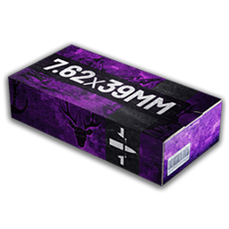

# 7.62x39mm

| 7.62x39mm | |
|---|---|
| {: .wiki-infobox-img } | |
| **General** | |
| Bullet types | Standard (FMJ), Flesh Damage (HP), Armor Piercing (AP) (each with a tracer version) |
| Weapons | 2 |
| Classes | Marksman rifle |
| **Ballistics** | |
| Muzzle velocity | 700 to 735 m/s |
| **Availability** | |
| Standard (FMJ) price | 40 cash (vendor lot of 10), not shown in the vendor list |
| Flesh Damage (HP) price | 90 cash (vendor lot of 10), not shown in the vendor list |
| Armor Piercing (AP) price | 150 cash (vendor lot of 10), not shown in the vendor list |
| Internal name | 762mm |
{: .wiki-infobox }

The 7.62x39mm caliber is used by 2 weapons in the weapon data, across the Marksman rifle class. Its rounds are Standard (FMJ), Flesh Damage (HP), Armor Piercing (AP). The tables below show how each type does against armor.

## Weapons that use it

| Weapon | Class | Fire rate | Upper torso, no armor, point blank |
|---|---|---:|---:|
| [SKS](../weapons/sks.md) | Marksman rifle | 420 rounds/min | 40.0 |
| [TCX-SPR](../weapons/tcx-spr.md) | Marksman rifle | 800 rounds/min | 29.1 |

Point-blank figures use standard rounds (buckshot for shotguns, per pellet), per hit, without falloff. See [Ammunition](../ammunition.md) for the bullet types.

## Ammunition types

Upper torso hits from the SKS at point blank range, per hit, without falloff. Armor changes these numbers a lot, so every armor class is shown.

| Ammo | No armor | Light | Medium | Heavy | Super heavy |
|---|---|---|---|---|---|
| Standard (FMJ) | 40.0 | 28.0 | 24.0 | 20.0 | 16.0 |
| Flesh Damage (HP) | 80.0 | 11.9 | 8.6 | 5.4 | 2.2 |
| Armor Piercing (AP) | 32.0 | 27.2 | 25.6 | 24.0 | 22.4 |
| Standard (FMJ) with tracer | 40.0 | 28.0 | 24.0 | 20.0 | 16.0 |

Flesh Damage (HP) with tracer, Armor Piercing (AP) with tracer match their base type in the data.

## Against armor

- Armor Piercing does less damage than standard rounds up to light armor and more damage from medium armor up.
- Flesh Damage does 2.0 times the standard damage with no armor and 0.1 times against super heavy armor. It is the strongest type against unarmored targets. It is the weakest type against super heavy armor.

The numbers come from the upper torso column of the table above. Head hits follow the same pattern at higher values; see [Weapon Damage](../../game-features/Wardogs_WeaponDamage_v1.md).

## Season 2 changes

- The Season 2 changes page adds 1 magazine item for this caliber's tracer rounds.
- Weapons in this caliber with Season 2 changes: [SKS](../weapons/sks.md). Each article lists its changes.

## See also

- [Ammunition](../ammunition.md), the bullet types and which weapons use each caliber
- [Choosing Ammo](../guides/choosing-ammo.md), which round to load against each armor level
- [Armor](../game-mechanics/armor.md)
- [Ballistics](../game-mechanics/ballistics.md)
- [Weapons](../weapons.md)

## Sources

- [Weapon Damage](../../game-features/Wardogs_WeaponDamage_v1.md): body-part and armor numbers
- [Season 2 Changes: Weapons & Ammo](../../season-2-changes/weapons-ammo.md)
- [Tag Display Text](../../content/Wardogs_TagDisplayText_v1.md): caliber names
- [weapon-damage.json](https://github.com/Kiyogitpy/wardogs-data-docs/blob/main/assets/data/weapon-damage.json): ammo types and damage by armor class
- [weapon-damage-falloff.json](https://github.com/Kiyogitpy/wardogs-data-docs/blob/main/assets/data/weapon-damage-falloff.json): muzzle velocity
- [ammo-availability.json](https://github.com/Kiyogitpy/wardogs-data-docs/blob/main/assets/data/ammo-availability.json): ammo prices
