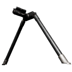
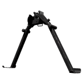
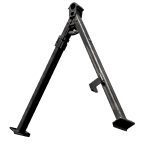
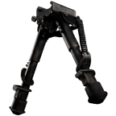

# Bipods

| Bipods | |
|---|---|
| **General** | |
| Slot | Underbarrel (folding legs) |
| Parts in data | 9 |
| Fits on | Underbarrel slot of the weapons listed in the table |
| **Performance** | |
| Stats changed | Grip Pod only: recoil, spread, aim time, sway; all bipods: turning limits while mounted |
| **Availability** | |
| Shop prices | 8 of 9 parts |
| Shop price range | 810 to 1,480 |
| Season 2 | 2 new, 1 price changes |
| Internal name | `Item.Attachment.Bipod` |
{: .wiki-infobox }

Bipods are folding legs that mount under the weapon. The data lists 9 parts: eight bipods and the Grip Pod, which the data files with them. Only the Grip Pod changes weapon or character numbers. The eight bipods change none; what they do in the data is limit how far the weapon can turn while mounted.

## What they change

Grip Pod, weapon side: vertical recoil x0.88; horizontal recoil x0.9; spread x0.94; aim time x1.1; equip speed x0.98.

Grip Pod, character side: aim sway speed x0.95; aim sway horizontal x0.9; aim sway vertical x0.88; sway translation stabilise x0.78; sway rotation stabilise x0.6.

The eight bipods list only multipliers of 1, so their weapon numbers stay as they are.

Mounted bipods: the data gives a separate effect list for the weapon and the character while a bipod is mounted, and that list replaces the unfolded one.

Stance limits: while mounted, each bipod sets how far the weapon can turn in each stance. Pitch lock runs from 15 to 50, yaw lock from 35 to 55, and the maximum change is 45 in yaw and 45 in pitch. The data gives these as angles, and the degree unit is inferred from the field names.

## Parts

Bipods are sold in the Weapon Shop, so most rows have a price. The Grip Pod has no shop price in the data.

| | Part | Fits | Shop price | Main effect |
|---|---|---|---:|---|
| {: .wiki-icon } | Evo-3 Ultra Bipod | Evo-3 Ultra | 1450 | No stat change in data |
|  | Grip Pod | AK74, AMP-9, Evo-3 Ultra, FAL, Galil, M249 SAW, M4, MP5, PP-19 Vityaz, Super-45, T-21, TCX-SPR | Not in shop data | vertical recoil x0.88; horizontal recoil x0.9; spread x0.94; aim time x1.1; equip speed x0.98; aim sway speed x0.95; aim sway horizontal x0.9; aim sway vertical x0.88; sway translation stabilise x0.78; sway rotation stabilise x0.6 |
| {: .wiki-icon } | M14 Bipod | M14 | 1480 | No stat change in data |
| {: .wiki-icon } | M249 Bipod | M249 SAW | 1050 | No stat change in data |
| {: .wiki-icon } | PKM Bipod | PKM | 1350 | No stat change in data |
| {: .wiki-icon } | Pro Tilt Bipod | AMR 50, BMR-308, MK22 | 1400 | No stat change in data |
| {: .wiki-icon } | SKS Bipod | SKS | 810 | No stat change in data |
| {: .wiki-icon } | SV98 Bipod | SV98 | 1250 | No stat change in data |
| {: .wiki-icon } | SVD Bipod | SVD | 1120 | No stat change in data |

## Season 2 changes

The Season 2 notes list no removed parts in this category.

New in Season 2: 2 parts: Evo-3 Ultra Bipod, M14 Bipod.

Shop price changes (Season 1 to Season 2):

| | Part | Season 1 | Season 2 | Change |
|---|---|---:|---:|---:|
| {: .wiki-icon } | SKS Bipod | 800 | 810 | +10 (+1.2%) |

The Season 2 notes also record bipod distance and ledge values whose min and max keys were swapped. The data page treats these as noise, so they are not listed here.

## See also

- [Attachments](../attachments.md), the list of attachment categories and what each slot does
- [Spread and Recoil](../game-mechanics/spread-and-recoil.md), how the recoil and spread multipliers combine
- [Weapons](../weapons.md)
- [Grips and Foregrips](grips.md)
- [Muzzle Devices](muzzle-devices.md)

## Sources

- [Attachments and Platforms](../../game-features/Wardogs_AttachmentsPlatforms_v1.md): every attachment item, the weapons and slots that take it, and the modifiers it applies.
- [Weapon Shop and Parts](../../game-features/Wardogs_WeaponShop_v1.md): display names, shop prices and component names.
- [Gameplay Effect Values](../../pipelines/Wardogs_GameplayEffect_Values_v1.md): the modifier values behind each effect.
- [weapon-loadouts.json](https://github.com/Kiyogitpy/wardogs-data-docs/blob/main/assets/data/weapon-loadouts.json): slot, part and effect data.
- [Season 2 changes: weapons and ammo](../../season-2-changes/weapons-ammo.md): Season 2 prices, new parts and sight values.
