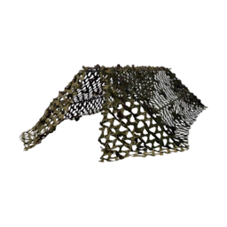

# Recon Tent

| Recon Tent | |
|---|---|
| {: .wiki-infobox-img } | |
| **General** | |
| Category | Cover and obstruction |
| Hammer | Small, Medium, Large |
| **Building** | |
| Build cost | 7 Build Supplies |
| Build time | 4 hits Small (2.3 s), 2 hits Medium (1.1 s), 2 hits Large (1.8 s). Derived from the hammer swing timing, not timed in play. |
| Health | 300 HP |
| **Damage** | |
| Bullets | -85% |
| Melee | -28% |
| Grenades | +0% |
| Rockets | +200% |
| C4 | +150% |
| IEDs | +500% |
| Internal name | `DA_Buildable_CamoNetTent` |
{: .wiki-infobox }

The Recon Tent is a small tent that any hammer can build. It costs 7 Build Supplies and has 300 HP. Its damage numbers are close to those of [Barbed Wire](barbed-wire.md), except that it has more health and takes more IED damage.

## Overview

The Recon Tent costs 7 Build Supplies and has 300 HP. It has no separate parts.

Destroying an enemy Recon Tent pays 5 cash and 5 Role XP.

## Building it

- **Cost:** 7 Build Supplies, whichever hammer builds it. Nothing is charged at placement.
- **Hammers:** Small, Medium or Large.
- **Placement:** The Recon Tent is one of the four small structures. It does not need a friendly base radius, but it cannot be placed inside an enemy base radius. It cannot be placed within 3 m of a safe zone or while standing in one, and not within 1 m of a ladder.
- **Stack limit:** 100.
- **Build stages:** Five, at 0, 25, 50, 75 and 100% of progress.
- **Weak spots:** switched off. Its build stages do not use the hammer bonus, so each hit adds the normal amount, multiplied by its build factor of 3.5 (see [Buildables](../building.md#building)).
- **Build time:** Estimated from the hits to build in the table below, one hit per swing (derived, not timed in play).

| Building it | Small hammer | Medium hammer | Large hammer |
|---|---:|---:|---:|
| Hits to build | 4 (about 2.3 s) | 2 (about 1.1 s) | 2 (about 1.8 s) |
| Hits to repair from zero health | 9 | 5 | 3 |
| Hits to dismantle (your own) | 2 | 2 | 2 |

Seconds are an estimate: one hammer hit per swing, 0.567 s per hit for the Small and Medium hammers and 0.883 s for the Large (derived from the use animation, not measured).

## What it does

The Recon Tent is cover. The data gives it no effect beyond its health and how it takes damage.

## Durability

| Source | Change | Share of damage that gets through |
|---|---:|---:|
| Bullets | -85% | 15% |
| Melee | -28% | 72% |
| Grenades | +0% | 100% |
| Rockets | +200% | 3 times |
| C4 | +150% | 2.5 times |
| IEDs | +500% | 6 times |

The table below gives the hits it takes to destroy, for each source. For how the percentages combine, see the [Damage Pipeline](../../pipelines/Wardogs_DamagePipeline_v2.md#6-arithmetic).

## Hits to destroy (point blank, derived)

Derived from each source's base damage and the damage table. It is not a count from play: each figure assumes every shot lands at point blank for full damage, with no falloff and no other rules, so real fights can differ. Base damage used: M4 5.56 mm FMJ 28, .50 cal FMJ 90, 120 mm rocket 150, M67 frag grenade 100 (it counts as a rocket against structures), C4 charge 250, IED 300. Each figure is the number of hits needed after every matching damage entry is applied.

| Structure | HP | M4 5.56 mm FMJ | .50 cal FMJ | 120 mm rocket | M67 frag grenade | C4 charge | IED |
|---|---:|---:|---:|---:|---:|---:|---:|
| Recon Tent | 300 | 72 | 23 | 1 | 1 | 1 | 1 |

## Season 2 changes

- The Season 2 data lists no change to the Recon Tent's cost or health.
- The Season 2 damage table gained a 125 mm shell entry for the Recon Tent, but its amount is 0, so nothing changed.

## See also

- [Building](../building.md): costs, hammers and placement for every structure
- [Barbed Wire](barbed-wire.md): the other small wire and cover structure

## Sources

- [Buildables](../../game-features/Wardogs_Buildables_v1.md): cost, health, stages, damage row, placement conditions and cash rewards
- [Damage Pipeline](../../pipelines/Wardogs_DamagePipeline_v2.md): how the percentage changes are applied (section 6)
- [Items and equipment changes, Season 2](../../season-2-changes/items-equipment.md): the buildable changes
- [Round 36 combat evidence](https://github.com/Kiyogitpy/wardogs-data-docs/blob/main/docs/evidence/round36-combat.md): derived hits to destroy for each source of damage.
- [Round 38 building evidence, native](https://github.com/Kiyogitpy/wardogs-data-docs/blob/main/docs/evidence/round38-building-native.md): the build, repair and dismantle arithmetic
- [Round 38 building evidence, data](https://github.com/Kiyogitpy/wardogs-data-docs/blob/main/docs/evidence/round38-building-data.md): weak spots, placement checks and the buildable settings
- [Round 42 buildables and economy evidence](https://github.com/Kiyogitpy/wardogs-data-docs/blob/main/docs/evidence/round42-econ-buildables.md): structure hit counts for every listed source (stacked damage entries, IED and the M67 as a rocket) and the build time estimates.
