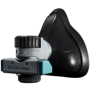

# Field Resuscitator

| Field Resuscitator | |
|---|---|
| {: .wiki-infobox-img } | |
| **General** | |
| Type | Medical, quick slot |
| Inventory size | 1 by 2 slots |
| Uses | Single use |
| **Effect** | |
| Revives | A downed teammate, to 10 HP |
| Use time | 2.2 s animation; the revive is applied once, about 4 s in total (derived) |
| Effects while using | Maximum movement speed halved |
| **Availability** | |
| Price | 425 cash (500 in Season 1) |
| Unlock level | 0 (shop data) |
| **Data** | |
| Internal name | `Id.Item.Resuscitator.Standard` |
{: .wiki-infobox }

The Field Resuscitator revives a downed teammate. It is a single-use item, and the shop describes it as a field revive that revives teammates faster than bare hands.

## Overview

The shop describes the Field Resuscitator as a field revive item that revives teammates faster and is single use. It works like the [Emergency Resuscitator](emergency-resuscitator.md), with the same use animation and container. The main difference in the data is the price, and the shop text does not limit it to one per life.

## Effects

- **Revive:** brings a downed teammate back to 10 HP. One revive is applied and the item is used up. On a player from the other faction, the revived player also gets a 60 s effect (see [Status Effects](../game-mechanics/status-effects.md)).
- **Container:** the item holds 10 units, emptied at 1 unit every 4 s. The revive is applied once when the use finishes, so the use takes about 4 s (derived). The container formula would give 44 s if all 10 units were stepped through, but the game does not do that.
- **Movement:** maximum movement speed is halved while the item is in use.
- **Bleeding:** the item does not stop bleeding. The game has no damage-over-time bleeding to cure.

### Medic skills

The Medic skill for base revive speed covers only the bare-hands revive, not this item, and it has no number in the data. The post-revive sprint boost applies after you revive a teammate, and it gives both you and the revived teammate 1.2 or 1.4 times sprint speed for 5 s.

## Use and timing

The use animation is 2.2 s, and the revive is applied at the end of it, so the total time is about 4 s (derived). The item can be used only on a teammate who is downed.

## Cost

The Item Shop lists the Field Resuscitator at 425 cash.

## Season 2 changes

The price fell from 500 cash in Season 1 to 425 cash in Season 2.

## See also

- [Emergency Resuscitator](emergency-resuscitator.md), the one-per-life revive item
- [Defibrillator](defibrillator.md), a battery-powered revive
- [Medical Items](medical-items.md)
- [Downed and Revive](../game-mechanics/downed-and-revive.md)

## Sources

- [Medical and Healing](../../game-features/Wardogs_Medical_v1.md): container, use time, movement effect and open revive questions
- [Item Shop for Non-Weapon Items](../../game-features/Wardogs_ItemShop_v1.md): shop text, price, size
- [Item Actions](../../content/Wardogs_ItemActions_v1.md): the shared resuscitator action and its animation
- [Progression Tables](../../game-features/Wardogs_Progression_v1.md): Medic skills
- [Items and Equipment, Season 2](../../season-2-changes/items-equipment.md): price change
- [Tag Display Text](../../content/Wardogs_TagDisplayText_v1.md): the Medical category label
- [Round 39 medical evidence](https://github.com/Kiyogitpy/wardogs-data-docs/blob/main/docs/evidence/round39-medical-movement.md): heal timing, skill rows, durability costs and status effects
- [Round 40 medical evidence](https://github.com/Kiyogitpy/wardogs-data-docs/blob/main/docs/evidence/round40-medical-movement.md): revive health, decay and armour values
