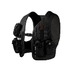

# Level 1 Armor

| Level 1 Armor | |
|---|---|
| {: .wiki-infobox-img } | |
| **General** | |
| Type | Vest |
| Slot | Armor |
| Weight | 3 kg |
| **Protection** | |
| Damage reduction | 30% |
| Body parts covered | Torso: upper, middle and lower |
| Durability | 200 |
| **Availability** | |
| Price | 400 cash |
| Unlock | None (unlock level 0) |
| **Reference** | |
| Internal name | `ID_LightArmor` (item `Id.Item.LightArmor`) |
{: .wiki-infobox }

Level 1 Armor is the lightest of the four vests and the cheapest of them. It protects the upper, middle and lower torso and cuts damage there by 30%. It needs no unlock, so it can be bought from the start.

## Overview

Level 1 Armor is the first vest tier. The Item Shop describes it as "Low Damage Reduction" and says it protects the upper and lower torso. The item data lists three torso areas, upper, middle and lower, so the middle torso is covered as well.

The vest goes in the Armor slot, and it does not cover the pelvis, arms or legs. Tactical vests are a different item. They are in the Tac-Vest slot, add quick slots and give no protection. For how armor is applied to a hit, see [Armor](../game-mechanics/armor.md). For all the vests and helmets, see [Body Armor](body-armor.md).

## Protection

Level 1 Armor reduces damage taken at the upper, middle and lower torso by 30%. It does nothing for the head, neck, pelvis, arms or legs. The item data gives it 200 durability.

With M4 full-metal-jacket rounds, an upper torso hit does 27.3 HP with no armor and 19.1 HP with Level 1 Armor.

| Vest | Damage reduction | Body parts covered | Durability |
|---|---:|---|---:|
| **Level 1 Armor** | 30% | Torso (upper, middle, lower) | 200 |
| [Level 2 Armor](level-2-armor.md) | 40% | Torso (upper, middle, lower) | 220 |
| [Level 3 Armor](level-3-armor.md) | 50% | Torso (upper, middle, lower) | 250 |
| [Level 4 Armor](level-4-armor.md) | 60% | Torso, pelvis, upper arms | 300 |

Each hit on a covered body part takes durability from the piece. For an ordinary bullet the game code removes 0.4 times the incoming damage, and the piece breaks when durability reaches 0 (from the game code; the game itself was not run to confirm it). Wear does not weaken protection: all four durability stages give the same reduction, so a worn piece protects as well as a new one until it breaks.

## Season 2 changes

The Season 2 data does not change Level 1 Armor.

## See also

- [Body Armor](body-armor.md)
- [Level 2 Armor](level-2-armor.md), [Level 3 Armor](level-3-armor.md), [Level 4 Armor](level-4-armor.md)
- [Armor (mechanic)](../game-mechanics/armor.md)
- [Choosing Ammo](../guides/choosing-ammo.md)

## Sources

- [Item Shop for Non-Weapon Items](../../game-features/Wardogs_ItemShop_v1.md): price, unlock, durability, reduction and covered body parts
- [Items data](../../content/Wardogs_Items_v2.md): weight and item id
- [Weapon Damage](../../game-features/Wardogs_WeaponDamage_v1.md): M4 damage by body part with and without armor
- [Weapon damage locations data](https://github.com/Kiyogitpy/wardogs-data-docs/blob/main/assets/data/weapon-damage-locations.json): covered body parts and reduction per armor item
- [Items and Equipment changes, Season 2](../../season-2-changes/items-equipment.md)
- [Tag Display Text](../../content/Wardogs_TagDisplayText_v1.md): slot and category names
- [Body Armor](body-armor.md): the overview of all armor
- [Round 40 medical, armour and movement evidence](https://github.com/Kiyogitpy/wardogs-data-docs/blob/main/docs/evidence/round40-medical-movement.md): durability per piece, the armour damage rule and the helmet weights
