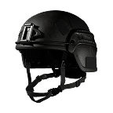

# Level 3 Helmet

| Level 3 Helmet | |
|---|---|
| {: .wiki-infobox-img } | |
| **General** | |
| Type | Helmet |
| Slot | Helmet |
| Weight | 3 kg |
| **Protection** | |
| Damage reduction | 50% (55% in Season 1) |
| Body parts covered | Head and neck |
| Durability | 180 |
| **Availability** | |
| Price | 2,000 cash (1,500 in Season 1) |
| Unlock | None (unlock level 0) |
| **Reference** | |
| Internal name | `ID_HeavyHelmet` (item `Id.Item.HeavyHelmet`) |
{: .wiki-infobox }

Level 3 Helmet is the third of the four helmet tiers. It protects the head and neck and cuts damage there by 50%. In Season 2 its reduction went down and its price went up. It needs no unlock.

## Overview

Level 3 Helmet is the first helmet tier that covers the neck. The Item Shop describes it as "High Damage Reduction", and it adds that the helmet gives a "Low Suppression Reduction". The item data lists the head and neck.

It goes in the Helmet slot and weighs 3. For all the vests and helmets, see [Body Armor](body-armor.md).

## Protection

Level 3 Helmet reduces damage to the head and neck by 50%. It does nothing for the body. The item data gives it 180 durability.

With M4 full-metal-jacket rounds:

- Head: 65.8 HP with no helmet, 32.9 HP with Level 3 Helmet.
- Neck: 49.4 HP with no helmet, 24.7 HP with Level 3 Helmet.

| Helmet | Damage reduction | Body parts covered | Durability |
|---|---:|---|---:|
| [Level 1 Helmet](level-1-helmet.md) | 30% | Head | 80 |
| [Level 2 Helmet](level-2-helmet.md) | 40% | Head | 100 |
| **Level 3 Helmet** | 50% | Head and neck | 180 |
| [Level 4 Helmet](level-4-helmet.md) | 60% | Head and neck | 200 |
| [Pilot Helmet](pilot-helmet.md) | 30% | Head | 180 |
| [Tank Helmet](tank-helmet.md) | 55% | Head and neck | 180 |

Each hit on a covered body part takes durability from the piece. For an ordinary bullet the game code removes 0.4 times the incoming damage, and the piece breaks when durability reaches 0 (from the game code; the game itself was not run to confirm it). Wear does not weaken protection: all four durability stages give the same reduction, so a worn piece protects as well as a new one until it breaks.

## Season 2 changes

| Property | Season 1 | Season 2 |
|---|---|---|
| Damage reduction | 55% | 50% |
| Price | 1,500 cash | 2,000 cash |

The Season 2 data lists only these two changes for this helmet.

## See also

- [Body Armor](body-armor.md)
- [Level 1 Helmet](level-1-helmet.md), [Level 2 Helmet](level-2-helmet.md), [Level 4 Helmet](level-4-helmet.md)
- [Pilot Helmet](pilot-helmet.md), [Tank Helmet](tank-helmet.md)
- [Armor (mechanic)](../game-mechanics/armor.md)
- [Choosing Ammo](../guides/choosing-ammo.md)

## Sources

- [Item Shop for Non-Weapon Items](../../game-features/Wardogs_ItemShop_v1.md): price, unlock, durability, reduction and covered body parts
- [Items data](../../content/Wardogs_Items_v2.md): weight and item id
- [Weapon Damage](../../game-features/Wardogs_WeaponDamage_v1.md): M4 damage by body part with and without armor
- [Weapon damage locations data](https://github.com/Kiyogitpy/wardogs-data-docs/blob/main/assets/data/weapon-damage-locations.json): covered body parts and reduction per armor item
- [Items and Equipment changes, Season 2](../../season-2-changes/items-equipment.md): reduction and price changes
- [Tag Display Text](../../content/Wardogs_TagDisplayText_v1.md): slot and category names
- [Body Armor](body-armor.md): the overview of all armor
- [Round 40 medical, armour and movement evidence](https://github.com/Kiyogitpy/wardogs-data-docs/blob/main/docs/evidence/round40-medical-movement.md): durability per piece, the armour damage rule and the helmet weights
