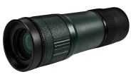

# Monocular

| Monocular | |
|---|---|
| {: .wiki-infobox-img } | |
| **General** | |
| Type | Recon, specialist item |
| Use | Spot enemy infantry and vehicles |
| Weight | 0.28 kg |
| **Use** | |
| Magnification | Medium, variable |
| Distance readout | None in the shop text |
| **Availability** | |
| Price | 350 cash |
| Unlock level | 0 |
| **Data** | |
| Internal name | `ID.Item.Monocular` |
{: .wiki-infobox }

The Monocular is the middle recon optic in price and power. It has a medium magnification that can be varied, and it is used to spot enemy infantry and vehicles. It is more expensive than the [Binoculars](binoculars.md) and cheaper than the [Range Finder](range-finder.md).

## Overview

The shop text describes the Monocular as spotting enemy infantry and vehicles with medium, variable magnification. Unlike the Range Finder and the Infrared Range Finder, its shop text does not mention an accurate distance readout. The data gives no spotting range. The data gives spot timing instead of a range: a spot registers in 0.5 s on infantry and 0.75 s to 1.25 s on vehicles, and fades over 30 s on infantry (see [Spotting](../game-mechanics/spotting.md)).

## How it works

- It is used by aiming, with the item's secondary input.
- The item data places it in the same aim action as the Range Finder, so the two share controls.
- While it is in use, maximum movement speed is halved.

The data gives the Monocular no reload action.

## Season 2 changes

| Item | Season 1 | Season 2 |
|---|---:|---:|
| Monocular price (cash) | 150 | 350 |

## See also

- [Binoculars](binoculars.md)
- [Range Finder](range-finder.md)
- [Infrared Range Finder](infrared-range-finder.md)
- [Utility Items](utility-items.md)
- [Optics Comparison](optics-comparison.md)

## Sources

- [Item Shop for Non-Weapon Items](../../game-features/Wardogs_ItemShop_v1.md): price, unlock level, shop text, weight
- [Item Actions](../../content/Wardogs_ItemActions_v1.md): the shared aim action and movement effect
- [Items and Equipment, Season 2](../../season-2-changes/items-equipment.md): price change
