# Vehicles

Wardogs has helicopters, a fixed-wing airplane, tanks and armored vehicles, and a range of trucks, SUVs and buggies. Most are bought from the vehicle vendor for cash and unlock at level 0 or 1. Each article gives the seats, health, weapons, handling and Season 2 changes for one vehicle. [Vehicle damage](vehicles/vehicle-damage.md) explains how they take hits.

The numbers come from the data pages and are shown as stored. The data does not label its speed and fuel units, so those are plain numbers. Main health is in HP. "Rifle damage taken" is worked out from the damage rules for a full-power 5.56 mm hit to the hull. It shows how much of a rifle round's damage gets through. It is not an official armor rating.

## Helicopters

| | Vehicle | Type | Seats | Price (cash) | Main health (HP) | Top speed (as stored) | Rifle damage taken (derived) |
|---|---|---|---:|---:|---:|---:|---:|
| 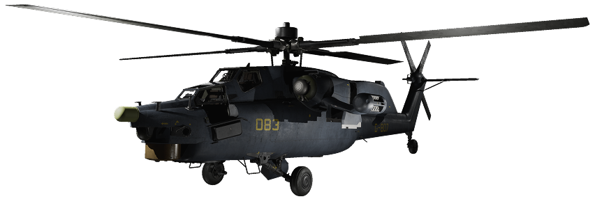{: .wiki-icon } | [Havoc](vehicles/havoc.md) | Combat helicopter | 2 | 28,000 | 800 | 400 | 5% |
| 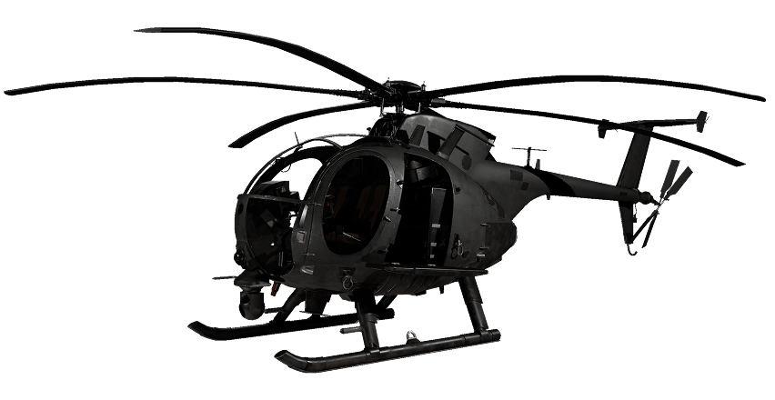{: .wiki-icon } | [MH-6](vehicles/mh-6.md) | Transport helicopter | 6 | 6,250 | 400 | 350 | 7.5% |
| 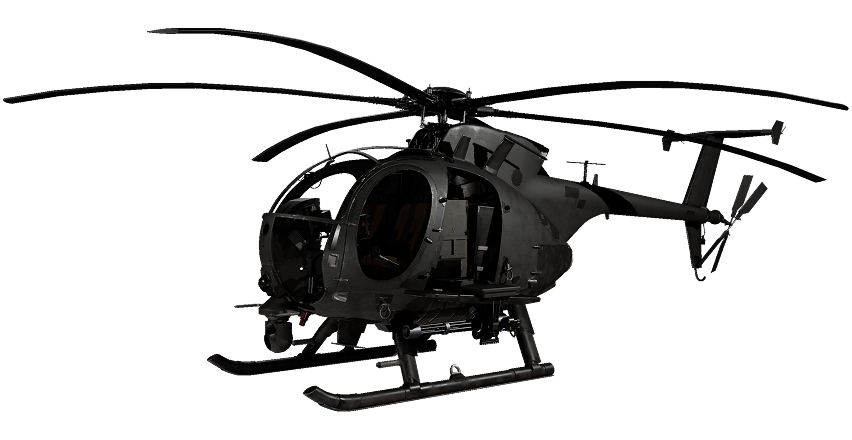{: .wiki-icon } | [AH-6M [Miniguns]](vehicles/ah-6m-miniguns.md) | Combat helicopter (miniguns) | 2 | 12,000 | 400 | 350 | 7.5% |
| 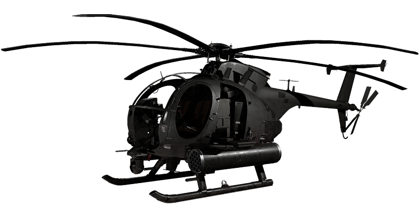{: .wiki-icon } | [AH-6R [Rockets]](vehicles/ah-6r-rockets.md) | Combat helicopter (rockets) | 2 | 18,800 | 400 | 350 | 7.5% |
| 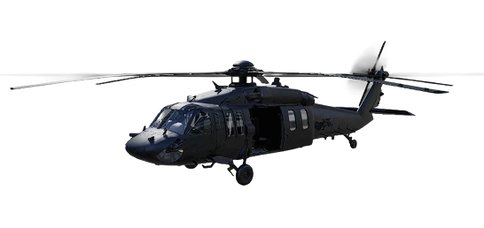{: .wiki-icon } | [Z20 Lakota](vehicles/z20-lakota.md) | Transport helicopter | 13 | 7,400 | 600 | 445 | 5% |
| 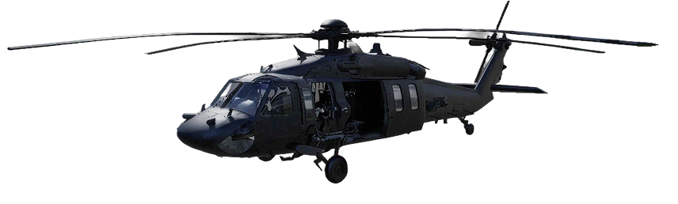{: .wiki-icon } | [Z20 Lakota [Miniguns]](vehicles/z20-lakota-miniguns.md) | Combat helicopter | 13 | 15,000 | 600 | 445 | 5% |
|  | [Huey](vehicles/huey.md) | Helicopter (not in the shop) | Not stored | Not sold | Not stored | Not stored | Not stored |

## Armored vehicles

| | Vehicle | Type | Seats | Price (cash) | Main health (HP) | Top speed (as stored) | Rifle damage taken (derived) |
|---|---|---|---:|---:|---:|---:|---:|
| 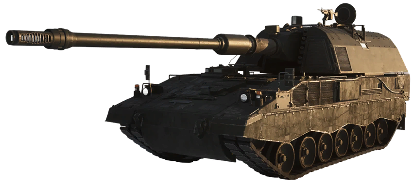{: .wiki-icon } | [SPH-2](vehicles/sph-2.md) | Artillery vehicle | 3 | 8,000 | 650 | 65 | 0% |
| 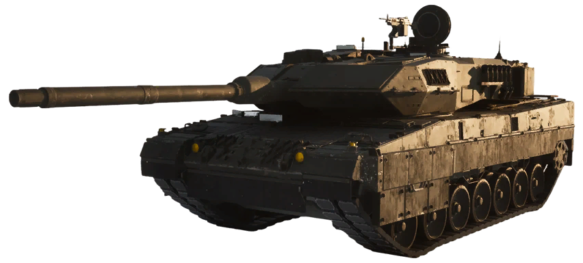{: .wiki-icon } | [L2A6](vehicles/l2a6.md) | Heavy tank | 3 | 22,000 | 800 | 65 | 0% |
| 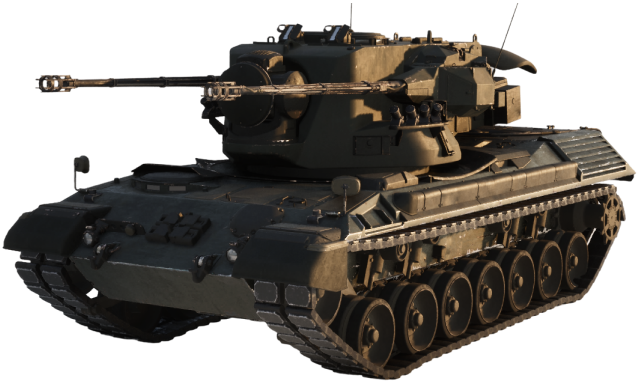{: .wiki-icon } | [Flakpanzer Gepard](vehicles/flakpanzer-gepard.md) | Anti-air tank | 2 | 14,000 | 800 | 65 | 0% |
| 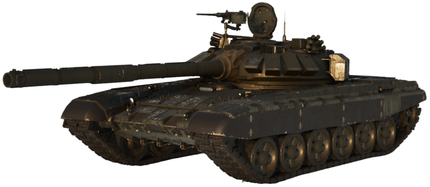{: .wiki-icon } | [T-72B3](vehicles/t-72b3.md) | Heavy tank | 3 | 16,000 | 750 | 60 | 0% |
| {: .wiki-icon } | [M113 APC SV](vehicles/m113-apc-sv.md) | Armored personnel carrier | 10 | Not sold | 1,000 | 71 | 0% on hull and tracks |

## Cars and trucks

| | Vehicle | Type | Seats | Price (cash) | Main health (HP) | Top speed (as stored) | Rifle damage taken (derived) |
|---|---|---|---:|---:|---:|---:|---:|
| {: .wiki-icon } | [Bobcat](vehicles/bobcat.md) | Light utility vehicle | 2 | 500 | 200 | 75 | 7.5% |
| 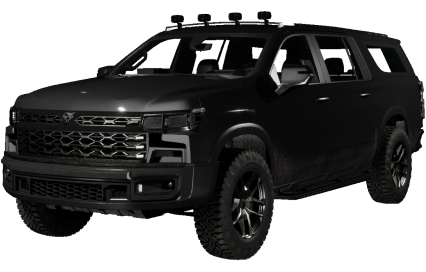{: .wiki-icon } | [Kodiak](vehicles/kodiak.md) | SUV | 4 | 2,500 | 400 | 154 | 5% |
| 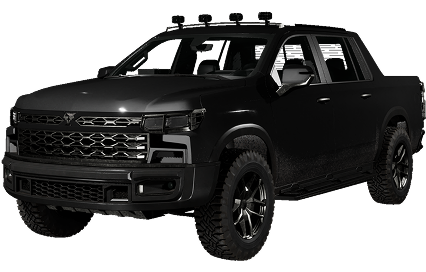{: .wiki-icon } | [Kodiak [Pickup]](vehicles/kodiak-pickup.md) | Pickup | 6 | 3,000 | 400 | 154 | 5% |
| 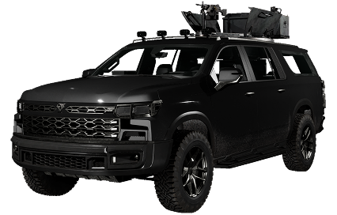{: .wiki-icon } | [Kodiak [M249]](vehicles/kodiak-m249.md) | SUV with machine gun | 5 | 6,750 | 400 | 154 | 5% |
| 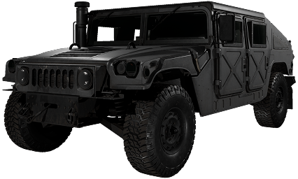{: .wiki-icon } | [Humvee](vehicles/humvee.md) | Light armored SUV | 4 | 3,000 | 500 | 113.2 | 5% |
| {: .wiki-icon } | [Humvee [Minigun]](vehicles/humvee-minigun.md) | Light armored SUV with minigun | 5 | 10,000 | 500 | 113.2 | 2.5% |
| {: .wiki-icon } | [Humvee [M249]](vehicles/humvee-m249.md) | Light armored SUV with machine gun | 5 | 8,500 | 500 | 113.2 | 4% |
| 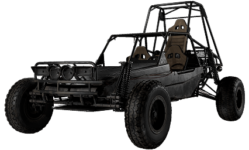{: .wiki-icon } | [Dune Buggy](vehicles/dune-buggy.md) | Buggy | 3 | 1,500 | 400 | 130 | 10% |
| 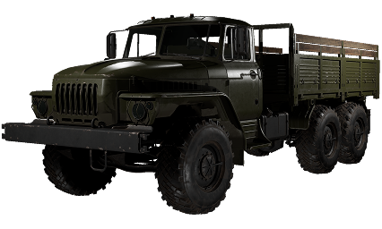{: .wiki-icon } | [Ural](vehicles/ural.md) | Truck | 3 | 5,000 | 700 | 79 | 5% |
| 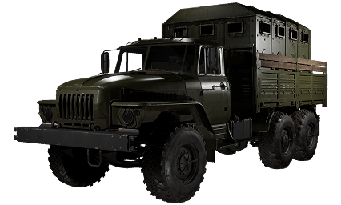{: .wiki-icon } | [Ural Defender](vehicles/ural-defender.md) | Heavy truck | 3 | 7,200 | 700 | 79 | 5% |
| 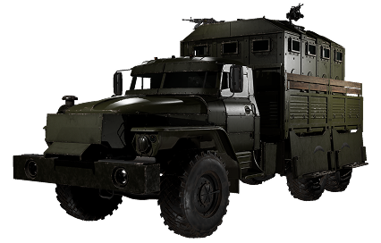{: .wiki-icon } | [Ural Defender [M249]](vehicles/ural-defender-m249.md) | Heavy truck with machine gun | 3 | 9,500 | 700 | 79 | 5% |
| 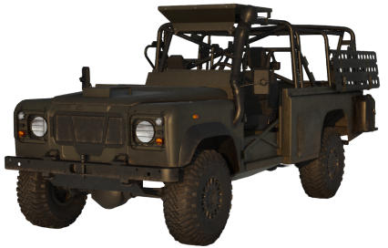{: .wiki-icon } | [Wolf-110](vehicles/wolf-110.md) | SUV | 4 | 2,200 | 500 | 129 | 5% |
| 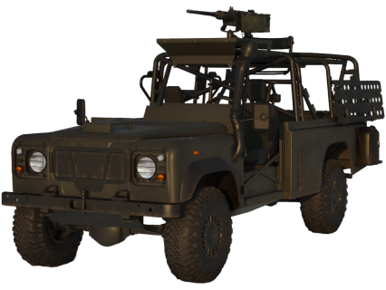{: .wiki-icon } | [Wolf-110 [M2 Browning]](vehicles/wolf-110-m2-browning.md) | SUV with machine gun | 5 | 7,800 | 500 | 129 | 4.5% |

## Aircraft

| Vehicle | Type | Seats | Price (cash) | Main health (HP) | Top speed (as stored) | Rifle damage taken (derived) |
|---|---|---:|---:|---:|---:|---:|
| [Fixed-wing airplane](vehicles/fixed-wing-airplane.md) | Airplane | 2 | Not sold | 150 at start | Not stored | 7.5% |

Stationary emplacements are built as buildables and cannot be driven, so they are listed under Building instead: [Talon 9K-SAM](building/talon-9k-sam.md), [Vanguard CIWS](building/vanguard-ciws.md), [L81 Mortar](building/l81-mortar.md), [Loudspeaker](building/loudspeaker.md), [Stingray](building/stingray.md) and [MG Nest](building/mg-nest.md). The guns mounted on vehicles are collected in [Vehicle weapons](vehicles/vehicle-weapons.md). Reference articles cover [fuel and refueling](vehicles/fuel-and-refueling.md), [repair and vehicle parts](vehicles/repair-and-vehicle-parts.md), [vehicle handling](vehicles/vehicle-handling.md), [countermeasures and flares](vehicles/countermeasures-and-flares.md) and [seats and passengers](vehicles/seats-and-passengers.md). The data lists no boats.

## Reference

| Article | What it covers |
|---|---|
| [Vehicle Comparison](vehicles/vehicle-comparison.md) | Every vehicle's seats, price, health, speed, fuel, weapons, countermeasures and damage numbers in one sortable table, with hits to destroy and value for money. |

## Sources

- [All-Vehicle Stat & Damage Sheets](../content/Wardogs_AllVehicles_Stats_Damage_v1.md)
- [Vehicles (feature)](../game-features/Wardogs_GameFeatures_Vehicles_v2.md)
- [Vehicle parts and handling](../game-features/Wardogs_VehicleHandling_v1.md)
- [Item Shop](../game-features/Wardogs_ItemShop_v1.md)
- [Vehicle Damage Pipeline](../pipelines/Wardogs_VehicleDamagePipeline_v1.md)
- [Season 2 Changes: Vehicles](../season-2-changes/vehicles.md)

