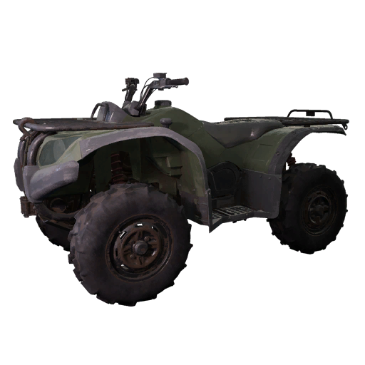

# Bobcat

| Bobcat | |
|---|---|
| {: .wiki-infobox-img } | |
| Type | Light utility vehicle (quad bike) |
| Seats | 2 |
| Price | 500 cash |
| Unlock level | 0 |
| Main health | 200 HP |
| Top speed | 75 (as stored) |
| Rifle damage taken (derived) | 7.5% |
| 3D hitboxes | [Open in the viewer](https://kiyogitpy.github.io/wardogs-data-docs/pipelines/vehicle-viewer.html#land-wheeled-bobcat) |
| Internal name | WHL_01 |
{: .wiki-infobox }

The Bobcat is a two-seat quad bike and the cheapest wheeled vehicle in the vehicle vendor at 500 cash. It has no weapons and a light frame, so it has the lowest main health of the wheeled vehicles.

## Overview

The Bobcat is sold in the vehicle vendor under land transport, for 500 cash, and unlocks at level 0. Its shop description calls it a cheap two-seat transport vehicle.

## Stats

| Stat | Value |
|---|---|
| Max speed | 75 (as stored) |
| Fuel capacity | 18 (as stored) |
| Fuel economy | 2.2 (as stored) |
| Seats | 2 |
| Mass | 250 (as stored, unit not stated) |
| Countermeasures | Not stated |

## Armor and damage

Main health is 200 HP. The Bobcat has separate health for its engine (200 HP), fuel tank (100 HP) and each wheel (75 HP).

Rifle rounds do 7.5% of their damage against the hull. Hits to a wheel can destroy the vehicle faster than hits to the body.

Hits needed to destroy the main health. These counts are derived by simulating the damage rules with full-power, point-blank, standard (FMJ) hits; they are estimates from the data, not measured in game:

| Ammunition | Hits to destroy | Faster route |
|---|---:|---|
| 5.56 mm rifle | 96 | 64 through the left front wheel |
| 7.62×54 mm rifle | 61 | 40 through the left front wheel |
| .308 Win | 170 | 113 through the left front wheel |
| .50 cal | 30 | 20 through the left front wheel |
| 20×102 mm cannon | 14 | None found |
| 30 mm cannon | 2 | None found |

## Weapons and seats

The Bobcat has no weapons. Its two seats are a driver and a passenger.

## Handling

- Mass 250, hand brake 8, and front steering of 35 degrees.
- Torque split of 0.6 to the front and 0.4 to the rear.
- Engine idle 1,200 RPM, rev limit 7,000 RPM.
- Tyre radius at the front 0.35 (as stored).

**Steering and pedal tuning.** The data stores steer sensitivity 1.3, steer input gravity 1, a steering deadzone of 0.05, a steering assist of 20, throttle sensitivity 2 and brake sensitivity 1. It is the only wheeled set with a deadzone and an assist. The game does not label the units. (see [Vehicle handling](vehicle-handling.md#driving-input-tuning) for how these settings work).

- Torque scale is not stored; the game default of 1.0 applies.
- **Tyre states.** Each tyre has three states: intact; damaged (deflated), at or below 55% of the wheel's health; and destroyed, at 0. The wheel data stores a radius, friction and brake value for each state. [Repair and vehicle parts](repair-and-vehicle-parts.md) covers what each state does.

## Season 2 changes

- A new 125 mm rocket rule adds +250%.
- The vehicle item changed size in inventory (width 4 to 3, height 4 to 2).
- Wheel deflation threshold rose from 0.5 to 0.55 on both axles.
- Price is unchanged at 500.

## Vehicle spawns

The Bobcat is placed by the light vehicle yards of all four main maps: [Bakurani](../game-modes-and-maps/bakurani.md), [Ozeti](../game-modes-and-maps/ozeti.md), [Zestafona](../game-modes-and-maps/zestafona.md) and [Saburtulo](../game-modes-and-maps/saburtulo.md). Each side has one yard that allows only the Bobcat; a match offers it in all 3 light yards on each of the four maps. The data gives no vehicle count or respawn timer per yard. See [Vehicle Spawns](../../game-features/Wardogs_VehicleSpawns_v1.md).

## See also

- [Kodiak](kodiak.md), the next size up
- [Dune Buggy](dune-buggy.md), another light wheeled vehicle
- [Vehicle damage](vehicle-damage.md)

## Sources

- [Vehicle Spawns](../../game-features/Wardogs_VehicleSpawns_v1.md): which maps place this vehicle
- [Round 41 vehicles and explosives evidence](https://github.com/Kiyogitpy/wardogs-data-docs/blob/main/docs/evidence/round41-vehicles-explosives.md): the wheeled steering and pedal tuning for this vehicle
- [All-Vehicle Stat & Damage Sheets](../../content/Wardogs_AllVehicles_Stats_Damage_v1.md)
- [Vehicles (feature)](../../game-features/Wardogs_GameFeatures_Vehicles_v2.md)
- [Vehicle parts and handling](../../game-features/Wardogs_VehicleHandling_v1.md)
- [Vehicle Damage Pipeline](../../pipelines/Wardogs_VehicleDamagePipeline_v1.md)
- [Item Shop](../../game-features/Wardogs_ItemShop_v1.md)
- [Season 2 Changes: Vehicles](../../season-2-changes/vehicles.md)
- [Round 45 B evidence](https://github.com/Kiyogitpy/wardogs-data-docs/blob/main/docs/evidence/round45-b.md): wiki update notes and data findings for this article
