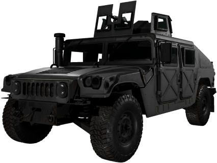

# Humvee [M249]

| Humvee [M249] | |
|---|---|
| {: .wiki-infobox-img } | |
| Type | Light armored SUV with machine gun |
| Seats | 5 |
| Price | 8,500 cash |
| Unlock level | 0 |
| Main health | 500 HP |
| Top speed | 113.2 (as stored) |
| Rifle damage taken (derived) | 4% |
| 3D hitboxes | [Open in the viewer](https://kiyogitpy.github.io/wardogs-data-docs/pipelines/vehicle-viewer.html#land-wheeled-humvee-machinegun) |
| Internal name | WHL_05 (machine gun variant) |
{: .wiki-infobox }

The Humvee [M249] is the [Humvee](humvee.md) with an M249 machine gun on a ring turret. It seats five.

## Overview

The Humvee [M249] is sold in the vehicle vendor under land transport, for 8,500 cash, and unlocks at level 0. Its Season 2 price went up from 3,750.

## Stats

| Stat | Value |
|---|---|
| Max speed | 113.2 (as stored) |
| Fuel capacity | 65 (as stored) |
| Fuel economy | 3.3 (as stored) |
| Seats | 5 |
| Mass | 7,250 (as stored, unit not stated) |
| Countermeasures | Not stated |

## Armor and damage

Main health is 500 HP, with the same engine, fuel tank and wheel health as the [Humvee](humvee.md). Rifle rounds do 4% of their damage against the hull.

Hits needed to destroy the main health. These counts are derived by simulating the damage rules with full-power, point-blank, standard (FMJ) hits; they are estimates from the data, not measured in game:

| Ammunition | Hits to destroy | Faster route |
|---|---:|---|
| 5.56 mm rifle | 893 | 161 through the fuel tank |
| 7.62×54 mm rifle | 569 | 103 through the fuel tank |
| .308 Win | 1,112 | 200 through the fuel tank |
| .50 cal | 278 | 50 through the fuel tank |
| 20×102 mm cannon | 62 | None found |
| 30 mm cannon | 23 | None found |

## Weapons and seats

| Weapon | Type | Rate | Effective range | Reload | Starting ammunition |
|---|---|---:|---:|---:|---:|
| M249 Machine Gun (ring turret) | Machine gun | 850 rounds/min | 700 m | 4.25 s | 0 (tracer) |

The gun fires 850 rounds/min out to 700 m. The data gives the reload time and the starting ammunition too (none loaded at the start, tracer rounds).

## Handling

Handling matches the base Humvee: mass 7,250, hand brake 80, front steering of 35 degrees, and the same torque split.

- **Tyre states.** Each tyre has three states: intact; damaged (deflated), at or below 55% of the wheel's health; and destroyed, at 0. The wheel data stores a radius, friction and brake value for each state. [Repair and vehicle parts](repair-and-vehicle-parts.md) covers what each state does.

## Season 2 changes

- Price rose from 3,750 to 8,500 cash.
- The gamepad aim sensitivity for the turret rose from 35 to 80.
- The 35×228 mm cannon rule changed from -69% to -86.5%.
- The 20×102 mm cannon rule changed from -87.5% to -86.5%.
- A new 125 mm rocket rule adds +250%.
- The vehicle item changed size in inventory (height 4 to 3).
- The front and rear torque split and wheel deflation changes that apply to all Humvee variants are listed on the [Humvee](humvee.md) article.

## Vehicle spawns

The Humvee [M249] is placed by the ground vehicle yards of all four main maps: [Bakurani](../game-modes-and-maps/bakurani.md), [Ozeti](../game-modes-and-maps/ozeti.md), [Zestafona](../game-modes-and-maps/zestafona.md) and [Saburtulo](../game-modes-and-maps/saburtulo.md). The yards list the vehicle family (Humvee, Humvee [M249] and Humvee [Minigun]), not each variant, so which variant appears in a slot is not in the data (inferred). A match offers it in 7 of the 7 ground yards on Ozeti, 5 or 6 of the 7 or 6 on Bakurani, 7 of 7 on Zestafona and 6 of 6 on Saburtulo. The data gives no vehicle count or respawn timer per yard. See [Vehicle Spawns](../../game-features/Wardogs_VehicleSpawns_v1.md).

## See also

- [Humvee](humvee.md) and [Humvee [Minigun]](humvee-minigun.md), the other Humvee variants
- [Kodiak [M249]](kodiak-m249.md), a similar machine gun SUV
- [Vehicle damage](vehicle-damage.md)

## Sources

- [Vehicle Spawns](../../game-features/Wardogs_VehicleSpawns_v1.md): which maps place this vehicle
- [All-Vehicle Stat & Damage Sheets](../../content/Wardogs_AllVehicles_Stats_Damage_v1.md)
- [Vehicles (feature)](../../game-features/Wardogs_GameFeatures_Vehicles_v2.md)
- [Vehicle parts and handling](../../game-features/Wardogs_VehicleHandling_v1.md)
- [Item Shop](../../game-features/Wardogs_ItemShop_v1.md)
- [Season 2 Changes: Vehicles](../../season-2-changes/vehicles.md)
- [Round 45 B evidence](https://github.com/Kiyogitpy/wardogs-data-docs/blob/main/docs/evidence/round45-b.md): wiki update notes and data findings for this article
