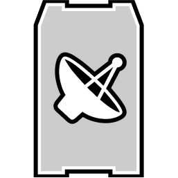

# M113 APC SV

| M113 APC SV | |
|---|---|
| {: .wiki-infobox-img } | |
| Type | Armored personnel carrier (spawn vehicle) |
| Seats | 10 (driver and 9 passengers) |
| Price | Not sold (no shop listing in the data) |
| Unlock level | Not applicable |
| Main health | 1,000 HP |
| Top speed | 71 (as stored) |
| Rifle damage taken (derived) | 0% on hull and tracks |
| 3D hitboxes | [Open in the viewer](https://kiyogitpy.github.io/wardogs-data-docs/pipelines/vehicle-viewer.html#land-tracked-leopard-spawn-spw-01) |
| Internal name | SPW_01 (Lonestar, Manticore and Valkyra faction versions) |
{: .wiki-infobox }

The M113 APC SV is a ten-seat tracked armored personnel carrier. It comes in three faction versions, Lonestar, Manticore and Valkyra, which share the same numbers in the data. It carries no weapons.

## Overview

The M113 APC SV is listed in the entity text table under the names Lonestar, Manticore and Valkyra, each described as a 10-seat tracked vehicle. The data has no shop row for it. Players get one at the side's deployment board in the spawn area (see Vehicle spawns below).

Its smoke countermeasure has 255 starting charges in the data. Smoke charges follow the vehicle inventory in the same way as flares: the smoke item must be added to the vehicle. The vehicle vendor sells smoke for 750 cash, one charge per purchase, the same as flares.

## Stats

| Stat | Value |
|---|---|
| Max speed | 71 (as stored) |
| Fuel capacity | 100 (as stored) |
| Fuel economy | 5.7 (as stored) |
| Seats | 10 |
| Max incline | 50 degrees |
| Countermeasures | Smoke (255 charges; screen active for 16 s, usable again after 90 s) |

## Armor and damage

Main health is 1,000 HP. The APC has separate health for its fuel tank (100 HP), each track (125 HP) and its radar (100 HP).

Rifle rounds do no damage to the hull and tracks, so rifle fire cannot destroy it. Cannon rounds do work:

| Ammunition | Hits to destroy |
|---|---:|
| 5.56 mm, 7.62×54 mm, .308 Win, .50 cal | Cannot be destroyed |
| 20×102 mm cannon | 366 |
| 30 mm cannon | 51 |

## Weapons and seats

The M113 APC SV has no weapons. It has ten seats: a driver and nine passenger seats.

## Handling

- Tracked drive with a top speed of 71 and a maximum incline of 50 degrees.
- The three faction versions share one configuration.

**Engine torque.** The torque curve is set against engine RPM up to 5,000 in the tracked drive data, and the torque values carry no unit label. See [Vehicle handling](vehicle-handling.md) for the other tracked numbers.

## Season 2 changes

- A new 125 mm rocket rule adds -10%.
- The 20×102 mm cannon rule changed from -60% to -84%, so cannon hits from that calibre now do less damage.
- Track rebound damping rose from 12,000 to 17,000.

## Vehicle spawns

Each side's spawn area has a deployment board that places this vehicle in the side's own version (Lonestar, Manticore or Valkyra): 3 boards per match on [Bakurani](../game-modes-and-maps/bakurani.md), [Ozeti](../game-modes-and-maps/ozeti.md), [Zestafona](../game-modes-and-maps/zestafona.md) and [Saburtulo](../game-modes-and-maps/saburtulo.md). Players deploy onto it from the board. Each board has 4 to 6 vehicle slots. In the Saburtulo data the Lonestar and Manticore boards sit in each other's spawn areas, and a few other mismatches between board and yard tags exist (see [Vehicle Spawns](../../game-features/Wardogs_VehicleSpawns_v1.md)). The board's built-in defaults set a 300 s vehicle respawn timer, a 60 s timer tied by name to a losing side, and a 600 s deploy cooldown per player. A destroyed APC most likely returns after 300 s (60 s for a losing side), but the code that uses these timers has not been traced, so this is inferred.

## See also

- [T-72B3](t-72b3.md), another tracked vehicle
- [Vehicle damage](vehicle-damage.md)

## Sources

- [Vehicle Spawns](../../game-features/Wardogs_VehicleSpawns_v1.md): which maps place this vehicle
- [Round 41 vehicles and explosives evidence](https://github.com/Kiyogitpy/wardogs-data-docs/blob/main/docs/evidence/round41-vehicles-explosives.md): the smoke screen's 16 s active window and 90 s cooldown, and the other round 41 vehicle readings
- [All-Vehicle Stat & Damage Sheets](../../content/Wardogs_AllVehicles_Stats_Damage_v1.md)
- [Vehicles (feature)](../../game-features/Wardogs_GameFeatures_Vehicles_v2.md)
- [Vehicle parts and handling](../../game-features/Wardogs_VehicleHandling_v1.md)
- [Vehicle Damage Pipeline](../../pipelines/Wardogs_VehicleDamagePipeline_v1.md)
- [Item Shop](../../game-features/Wardogs_ItemShop_v1.md)
- [Season 2 Changes: Vehicles](../../season-2-changes/vehicles.md)
- [Round 45 B evidence](https://github.com/Kiyogitpy/wardogs-data-docs/blob/main/docs/evidence/round45-b.md): wiki update notes and data findings for this article
