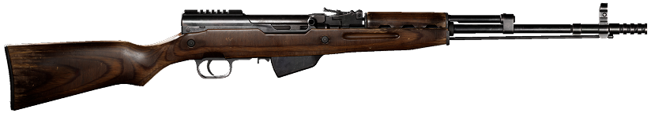

# SKS

| SKS | |
|---|---|
| {: .wiki-infobox-img } | |
| **General** |  |
| Class | Marksman rifle |
| Caliber | [7.62x39mm](../ammunition/7-62x39mm.md) |
| Fire modes | Semi-automatic |
| **Performance** |  |
| Fire rate | 420 rounds/min |
| Muzzle velocity | 735 m/s |
| Effective range | 400 m |
| Standard magazine | SKS Internal Mag (10 rounds) |
| **Availability** |  |
| Vendor price | 2400 |
| Unlock level | 1 |
| Internal name | SKS |
{: .wiki-infobox }

The SKS is a marksman rifle chambered in 7.62x39mm. It fires semi-automatic at 420 rounds/min. Its standard magazine is the SKS Internal Mag.

## Overview

Marksman rifles are the DMR class in the weapon data. Most are semi-automatic rifles.

It takes the bullet types described on the [Ammunition](../ammunition.md) page: Standard (FMJ), Flesh Damage (HP), Armor Piercing (AP). Each has a tracer version.

## Stats

| Stat | Value |
|---|---|
| Fire modes | Semi-automatic |
| Fire rate | 420 rounds/min |
| Muzzle velocity | 735 m/s |
| Effective range | 400 m |

## Damage

Figures are for Standard (FMJ) at point blank range, per hit, against a character without armor.

**By body part (no armor)**

| Body part | Damage |
|---|---|
| Head | 83.3 |
| Neck | 62.5 |
| Upper torso | 40.0 |
| Middle torso | 40.1 |
| Upper arm | 25.5 |
| Thigh | 25.5 |

**Armor (torso and head hits)**

| Armor class | Torso | Head |
|---|---|---|
| No armor | 40.0 | 83.3 |
| Light | 28.0 | 58.3 |
| Medium | 24.0 | 50.0 |
| Heavy | 20.0 | 41.7 |
| Super heavy | 16.0 | 33.3 |

**Range falloff (upper torso, no armor)**

| Distance | Damage |
|---|---|
| 0 m | 40.0 |
| 50 m | 40.0 |
| 100 m | 40.0 |
| 200 m | 40.0 |
| 300 m | 40.0 |
| 400 m | 40.0 |
| 600 m | 25.1 |
| 800 m | 16.7 |
| 1000 m | 10.0 |

**Upper torso, no armor, by ammo type**

| Ammo | Damage per hit |
|---|---|
| Standard (FMJ) | 40.0 |
| Flesh Damage (HP) | 80.0 |
| Armor Piercing (AP) | 32.0 |

See [Ammunition](../ammunition.md) for how each type does against armor, and [Weapon Damage](../../game-features/Wardogs_WeaponDamage_v1.md) for the full tables.

## Time to kill

Shots and time to kill (TTK) against a character with 100 HP. TTK runs from the first shot to the killing shot, so it is (shots - 1) x 60 / fire rate: one shot kills in 0 s.

**Upper torso hits, Standard (FMJ)**

| Vest | 10 m | 100 m | 300 m |
|---|---|---|---|
| No armor | 3 shots, 0.29 s | 3 shots, 0.29 s | 3 shots, 0.29 s |
| [Level 1 vest](../equipment/level-1-armor.md) | 4 shots, 0.43 s | 4 shots, 0.43 s | 4 shots, 0.43 s |
| [Level 2 vest](../equipment/level-2-armor.md) | 5 shots, 0.57 s | 5 shots, 0.57 s | 5 shots, 0.57 s |
| [Level 3 vest](../equipment/level-3-armor.md) | 5 shots, 0.57 s | 5 shots, 0.57 s | 5 shots, 0.57 s |
| [Level 4 vest](../equipment/level-4-armor.md) | 7 shots, 0.86 s | 7 shots, 0.86 s | 7 shots, 0.86 s |

**Head hits, Standard (FMJ)**

- At 10 m, no helmet: 2 shots, 0.14 s; Level 1 helmet: 2 shots, 0.14 s; Level 2 helmet: 2 shots, 0.14 s; Level 3 helmet: 3 shots, 0.29 s; Level 4 helmet: 4 shots, 0.43 s.
- At 100 m, no helmet: 2 shots, 0.14 s; Level 1 helmet: 2 shots, 0.14 s; Level 2 helmet: 2 shots, 0.14 s; Level 3 helmet: 3 shots, 0.29 s; Level 4 helmet: 4 shots, 0.43 s.

**Upper torso hits, Armor Piercing (AP)**

| Vest | 10 m | 100 m | 300 m |
|---|---|---|---|
| No armor | 4 shots, 0.43 s | 4 shots, 0.43 s | 4 shots, 0.43 s |
| [Level 1 vest](../equipment/level-1-armor.md) | 4 shots, 0.43 s | 4 shots, 0.43 s | 4 shots, 0.43 s |
| [Level 2 vest](../equipment/level-2-armor.md) | 4 shots, 0.43 s | 4 shots, 0.43 s | 4 shots, 0.43 s |
| [Level 3 vest](../equipment/level-3-armor.md) | 5 shots, 0.57 s | 5 shots, 0.57 s | 5 shots, 0.57 s |
| [Level 4 vest](../equipment/level-4-armor.md) | 5 shots, 0.57 s | 5 shots, 0.57 s | 5 shots, 0.57 s |

**Head hits, Armor Piercing (AP)**

- At 10 m, no helmet: 2 shots, 0.14 s; Level 1 helmet: 2 shots, 0.14 s; Level 2 helmet: 2 shots, 0.14 s; Level 3 helmet: 2 shots, 0.14 s; Level 4 helmet: 3 shots, 0.29 s.
- At 100 m, no helmet: 2 shots, 0.14 s; Level 1 helmet: 2 shots, 0.14 s; Level 2 helmet: 2 shots, 0.14 s; Level 3 helmet: 2 shots, 0.14 s; Level 4 helmet: 3 shots, 0.29 s.

Derived from the game data, not from play testing. It assumes every shot hits the stated part and that armor stays intact, and it ignores reload time, spread and recoil, so real fights take longer. Damage after the first 10 m comes from the range falloff curve. A * marks a distance beyond the weapon's effective range of 400 m, where damage falls with distance.

## Recoil and spread

Each bullet leaves the barrel in a random direction inside a cone around the point you aim at. Hip fire uses a wide cone that grows when you move. Aiming down the sights uses a very narrow one. Every shot also pushes the view up and to the side, following the weapon's recoil pattern.

**Spread**

| Situation | Still | Moving at full speed |
|---|---|---|
| Standing, hip fire | 3.0° | 6.0° |
| Crouching, hip fire | 2.0° | 4.0° |
| Prone, hip fire | 1.0° | 2.0° |
| In the air, hip fire | 10.0° | 10.0° |
| Aimed down sights | 0.0061° | 0.0061° |

Cone half-angles in degrees: a bullet can land up to that far from the aim point. At 100 m, standing hip fire has a radius of 5.2 m when still and 10.5 m at full speed; aimed, it is 0.01 m. Half of the shots land within half that radius.

Accuracy is 0.73 MOA, a full cone angle; the aimed row is half of it, in degrees.

- The data has no per-shot bloom and no recovery timer: nothing found in the spread data makes firing widen the spread, and spread changes only with speed, stance, being in the air and aiming. This comes from reading the game files, not from testing in game.
- Hip spread eases toward its new value with a time constant of about 0.04 s (a native default found by static reading).
- The 10° in-air figure is a native default found by static reading; only the grenade launcher's data sets it, to the same 10°.
- At full aim (aim blend exactly 1.0) hip spread is set to zero, so only the aimed row applies. A partly aimed weapon counts as hip fire.
- "Full speed" means 4 m/s standing, 2.5 m/s crouching and 0.5 m/s prone; between still and that speed the hip spread is a straight line.
- The figures are before attachments, which can change spread (see [Attachments](../attachments.md)).

**Recoil**

| Measure | Value |
|---|---|
| Shots in the recoil pattern | 20 |
| Kick on the first shot | 2.38° up |
| Climb after 10 shots | 33.6° up |
| Climb after 30 shots | 71.8° up |
| Average climb per shot over 30 shots | 2.39° up |
| Sideways drift after 30 shots | 12.8° left |
| Pattern resets after | 0.95 s without firing |
| Vertical kick crouching / prone, compared with standing | 0.85× / 0.70× |
| Default-loadout recoil multiplier, vertical / horizontal | 1 / 1 |

Climb and drift figures are computed from the pattern points, before the recoil multiplier. The game turns each authored kick by up to 5.5° per shot, so the real sideways drift varies from burst to burst. After shot 20 each kick is random inside the post-pattern range.

Season 2 changed the recoil pattern: the climb after 10 shots went from 13.4° to 33.6°, and after 30 shots from 32.9° to 71.8°; and the view kick multiplier went from 1.1 to 1.

To see the whole pattern as a picture, open the [Weapon Spray Viewer](https://kiyogitpy.github.io/wardogs-data-docs/pipelines/spray-viewer.html) and pick the SKS in the viewer.

## Ammunition

Ammo types for this weapon: Standard (FMJ), Standard (FMJ) with tracer, Flesh Damage (HP), Flesh Damage (HP) with tracer, Armor Piercing (AP), Armor Piercing (AP) with tracer. See [Ammunition](../ammunition.md).

## Attachments

Slots on this weapon: Barrel, Grip, Handguard, Magazine, Sight, Underbarrel. See [Attachments](../attachments.md) for what each part changes.

Default parts: magazine (SKS Internal Mag).

## Cost and unlocking

- Vendor price: 2400. The data pages do not decode the currency, so the price is shown as a plain number.
- Unlock level: 1.

## Season 2 changes

- Suppression effect multiplier: none to 1.1
- View kick multiplier removed
- Recoil pattern reworked

## See also

- [Weapons](../weapons.md)
- [Ammunition](../ammunition.md)
- [Attachments](../attachments.md)
- [Choosing Ammo](../guides/choosing-ammo.md)
- [Ballistics](../game-mechanics/ballistics.md)
- [Health and Damage](../game-mechanics/health-and-damage.md)
- [Spread and Recoil](../game-mechanics/spread-and-recoil.md)

## Sources

- [Weapon Shop and Parts](../../game-features/Wardogs_WeaponShop_v1.md): price, unlock level, default magazine
- [Infantry Weapon Stats](../../content/Wardogs_InfantryWeapons_Stats_v1.md): fire rate and fire modes
- [Weapon Damage](../../game-features/Wardogs_WeaponDamage_v1.md): body-part, armor and falloff numbers
- [Weapon Spread and Recoil Data](../../content/Wardogs_WeaponSpreadRecoilData_v1.md): spread and recoil inputs
- [Weapon Spread pipeline](../../pipelines/Wardogs_WeaponSpread_v1.md): how the aim cone and hip spread are computed
- [Spray Patterns Gallery](../../game-features/Wardogs_SprayPatterns_v1.md): recoil patterns, Season 1 and Season 2
- [weapon-spread-recoil.json](https://github.com/Kiyogitpy/wardogs-data-docs/blob/main/assets/data/weapon-spread-recoil.json): accuracy and hip spread curves
- [spray-patterns.json](https://github.com/Kiyogitpy/wardogs-data-docs/blob/main/assets/data/spray-patterns.json): recoil pattern points, Season 1 and Season 2
- [Season 2 Changes: Weapons & Ammo](../../season-2-changes/weapons-ammo.md)
- [Tag Display Text](../../content/Wardogs_TagDisplayText_v1.md): caliber and ammo names
- [weapon-loadouts.json](https://github.com/Kiyogitpy/wardogs-data-docs/blob/main/assets/data/weapon-loadouts.json): names, slots and effects
- [weapon-damage.json](https://github.com/Kiyogitpy/wardogs-data-docs/blob/main/assets/data/weapon-damage.json): body-part and armor damage
- [weapon-damage-falloff.json](https://github.com/Kiyogitpy/wardogs-data-docs/blob/main/assets/data/weapon-damage-falloff.json): falloff curves, also used for the time to kill table
- [weapon-capacity.json](https://github.com/Kiyogitpy/wardogs-data-docs/blob/main/assets/data/weapon-capacity.json): muzzle speed, effective range, chamber and magazine
- [Round 39 weapon evidence](https://github.com/Kiyogitpy/wardogs-data-docs/blob/main/docs/evidence/round39-weapons.md): launcher speeds and ranges, magazines, default rate
