# Spray Patterns Gallery

Every weapon's recoil spray pattern, one picture each, with Season 1 and Season 2 on the same axes. 38 infantry weapons are in the tables below by class; 23 vehicle, stationary and test entries are in the collapsed section at the end.

The interactive viewer is at [Spray Pattern Viewer](../pipelines/spray-viewer.html).

## Legend

- **Blue, dashed, round markers** = Season 1. **Green, solid, square markers** = Season 2.
- **Numbers on the path** = shot number (1, every 5th shot, and the last shot).
- **Shaded band** = the p10 to p90 range of the simulated spray (the area where most shots land).
- **x axis** = yaw in degrees, right is +. **y axis** = pitch in degrees, up is +. Each chart has its own scale, so read the tick labels.
- **Vertical climb** = how far the aim has risen after that many shots, in degrees.
- **RPM** = rounds per minute. **Reset time** = seconds of no fire before the pattern starts again.
- A dash (—) means the value is not in the exported data for that season.

## Assault rifles

| Name | Class | Shots in pattern | Vertical climb after 10 / 20 / 30 shots, degrees (S1 -> S2) | RPM (S1 -> S2) | Reset time (S1 -> S2) | Pattern image |
|---|---|---:|---|---:|---:|---|
| A-91 | AR | 30 -> 30 | 11.94 -> 11.94 / 23.73 -> 23.73 / 34.62 -> 34.62 | 700 -> 700 | 0.78 s -> 0.78 s | 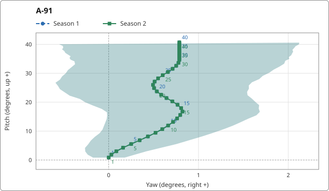 |
| AK74 | AR | 30 -> 30 | 11.09 -> 11.09 / 22.13 -> 22.13 / 32.46 -> 32.46 | 650 -> 650 | 0.65 s -> 0.65 s | 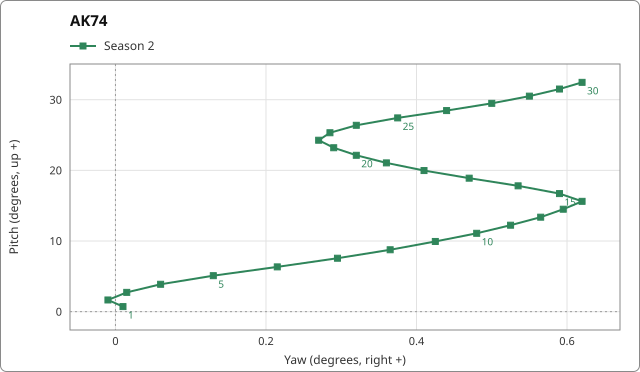 |
| Bushmaster M17S | AR | 30 -> 30 | 11.94 -> 11.94 / 23.73 -> 23.73 / 34.62 -> 34.62 | 700 -> 700 | 0.78 s -> 0.78 s | 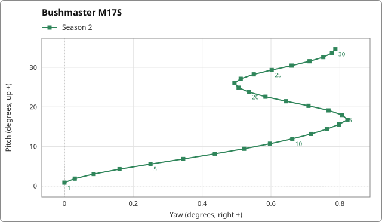 |
| FAL | AR | 20 -> 20 | 15.84 -> 15.84 / 30.85 -> 30.85 / 39.85 -> 39.85 | 650 -> 650 | 0.7 s -> 0.7 s | 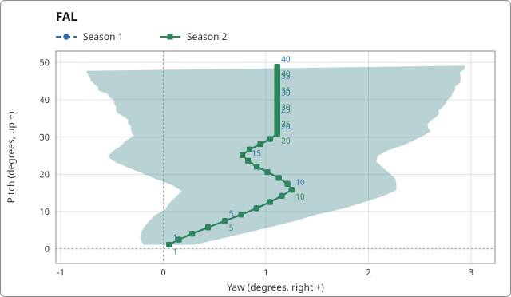 |
| Galil | AR | 30 -> 30 | 10.06 -> 10.06 / 21.34 -> 21.34 / 31.09 -> 31.09 | 650 -> 650 | 0.8 s -> 0.8 s | 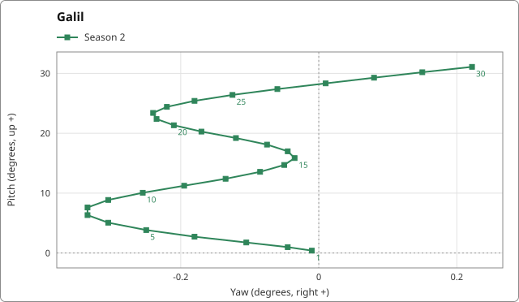 |
| KH-2002 | AR | 30 -> 30 | 11.94 -> 11.94 / 23.73 -> 23.73 / 34.62 -> 34.62 | 700 -> 700 | 0.78 s -> 0.78 s | 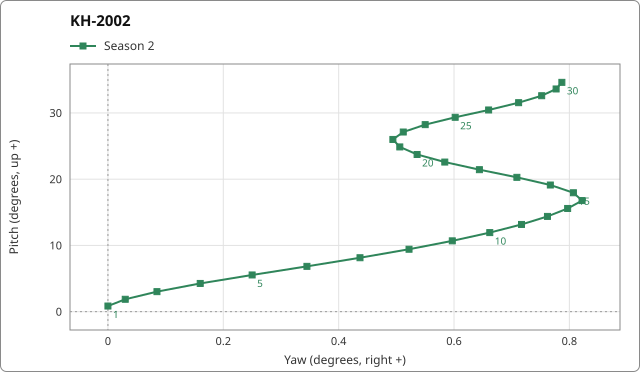 |
| M4 | AR | 30 -> 30 | 10.42 -> 10.42 / 20.53 -> 20.53 / 29.83 -> 29.83 | 800 -> 800 | 0.55 s -> 0.55 s | 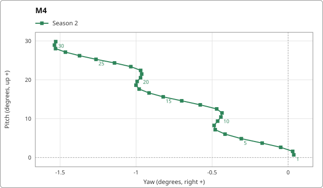 |
| T-21 | AR | 30 -> 30 | 11.21 -> 11.21 / 25.64 -> 25.64 / 42.4 -> 42.4 | 750 -> 750 | 0.8 s -> 0.8 s | 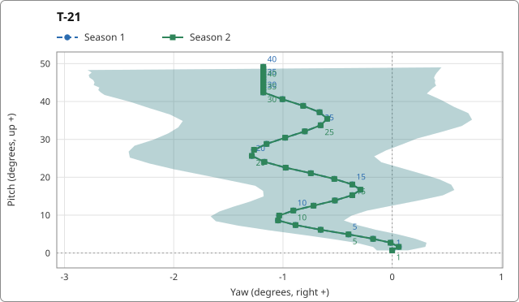 |
| TCX-SPR | AR | — -> 30 | — -> 15.91 / — -> 31.26 / — -> 45.76 | — -> 800 | — -> 0.5 s | 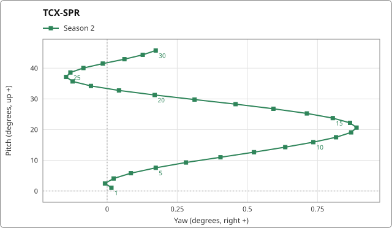 |

## Bows

| Name | Class | Shots in pattern | Vertical climb after 10 / 20 / 30 shots, degrees (S1 -> S2) | RPM (S1 -> S2) | Reset time (S1 -> S2) | Pattern image |
|---|---|---:|---|---:|---:|---|
| Compound Bow | Bow | none -> none | 25 -> 25 / 50 -> 50 / 75 -> 75 | 90 -> 90 | 0.2 s -> 0.2 s | 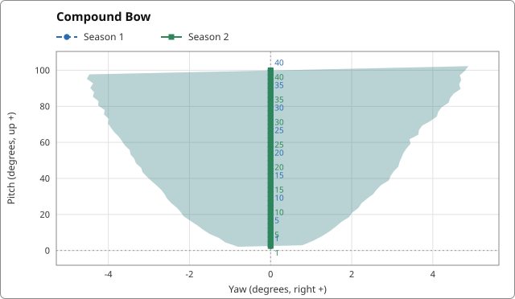 |

## Marksman rifles

| Name | Class | Shots in pattern | Vertical climb after 10 / 20 / 30 shots, degrees (S1 -> S2) | RPM (S1 -> S2) | Reset time (S1 -> S2) | Pattern image |
|---|---|---:|---|---:|---:|---|
| BMR-308 | DMR | 20 -> 20 | 14.19 -> 27.86 / 28.66 -> 52.6 / 37.26 -> 61.2 | 450 -> 450 | 1 s -> 1 s | 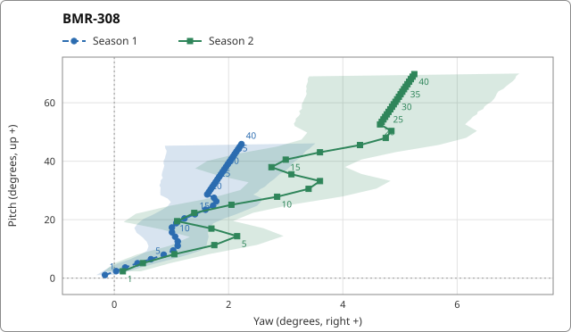 |
| M14 | DMR | — -> 32 | — -> 31.32 / — -> 65.52 / — -> 102.78 | — -> 700 | — -> 1.1 s | 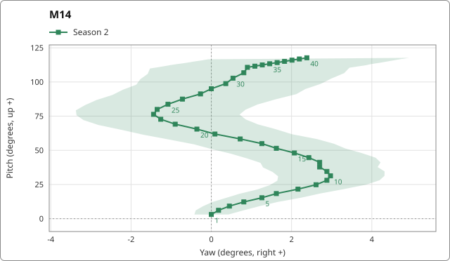 |
| SKS | DMR | 20 -> 20 | 13.45 -> 33.61 / 25.91 -> 64.76 / 32.91 -> 71.76 | 420 -> 420 | 0.95 s -> 0.95 s | 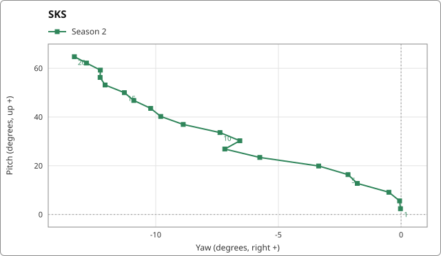 |
| SVD | DMR | 9 -> 9 | 19.82 -> 25.51 / 28.57 -> 34.26 / 37.33 -> 43.01 | 480 -> 480 | 1.1 s -> 1.1 s | 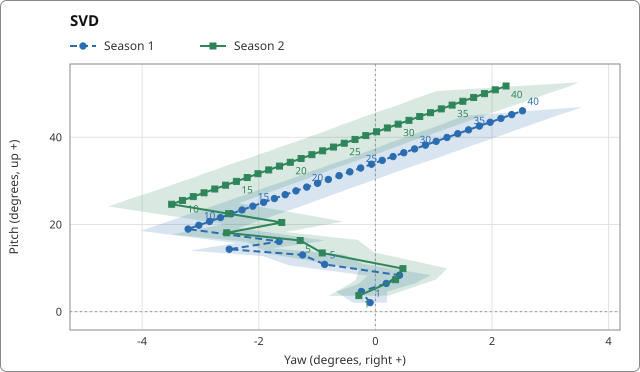 |

## Light machine guns

| Name | Class | Shots in pattern | Vertical climb after 10 / 20 / 30 shots, degrees (S1 -> S2) | RPM (S1 -> S2) | Reset time (S1 -> S2) | Pattern image |
|---|---|---:|---|---:|---:|---|
| Evo-3 Ultra | LMG | — -> 40 | — -> 30.98 / — -> 60.24 / — -> 87.9 | — -> 700 | — -> 0.75 s | 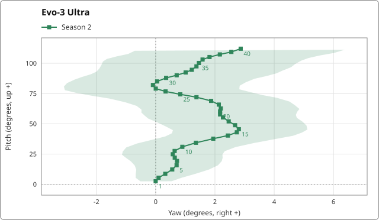 |
| M249 SAW | LMG | 7 -> 7 | 16.14 -> 16.14 / 26.14 -> 26.14 / 36.14 -> 36.14 | 850 -> 850 | 0.5 s -> 0.5 s | 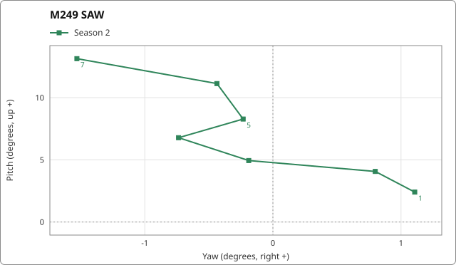 |
| PKM | LMG | 30 -> 30 | 24.02 -> 24.02 / 47.68 -> 47.68 / 68.11 -> 68.11 | 600 -> 600 | 0.9 s -> 0.9 s | 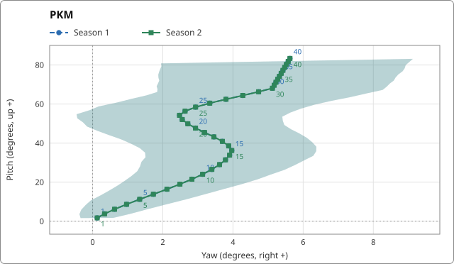 |

## Launchers

| Name | Class | Shots in pattern | Vertical climb after 10 / 20 / 30 shots, degrees (S1 -> S2) | RPM (S1 -> S2) | Reset time (S1 -> S2) | Pattern image |
|---|---|---:|---|---:|---:|---|
| 9K333 Verba | Launcher | none -> none | 15 -> 15 / 30 -> 30 / 45 -> 45 | 100 -> 100 | 0.5 s -> 0.5 s | 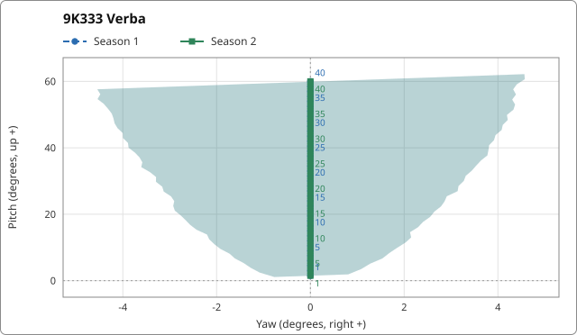 |
| MAAWS | Launcher | none -> none | 15 -> 15 / 30 -> 30 / 45 -> 45 | 100 -> 100 | 0.5 s -> 0.5 s | 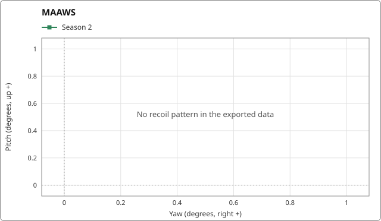 |
| MGL-40 | Launcher | none -> none | 15 -> 15 / 30 -> 30 / 45 -> 45 | 75 -> 75 | 0.5 s -> 0.5 s | 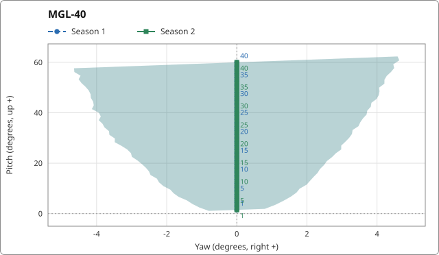 |
| RPG-7 | Launcher | none -> none | 15 -> 15 / 30 -> 30 / 45 -> 45 | 100 -> 100 | 0.5 s -> 0.5 s | 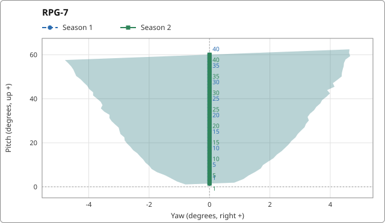 |

## Pistols

| Name | Class | Shots in pattern | Vertical climb after 10 / 20 / 30 shots, degrees (S1 -> S2) | RPM (S1 -> S2) | Reset time (S1 -> S2) | Pattern image |
|---|---|---:|---|---:|---:|---|
| Deagle | Pistol | 15 -> 15 | 13.05 -> 13.05 / 22.65 -> 22.65 / 28.9 -> 28.9 | 267 -> 267 | 0.5 s -> 0.5 s | 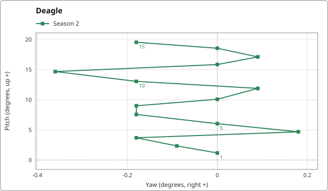 |
| GGX 17 | Pistol | none -> none | 7.5 -> 7.5 / 15 -> 15 / 22.5 -> 22.5 | 600 -> 600 | 0.5 s -> 0.5 s | 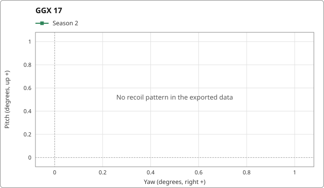 |
| GGX 18 | Pistol | 50 -> 50 | 15.88 -> 15.88 / 31.94 -> 31.94 / 41.94 -> 41.94 | 1200 -> 1200 | 0.5 s -> 0.5 s | 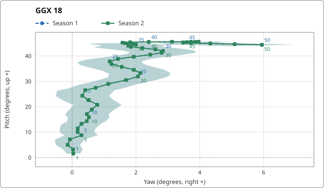 |
| Judge | Pistol | 1 -> 1 | 9 -> 9 / 16.5 -> 16.5 / 24 -> 24 | 200 -> 200 | 0.5 s -> 0.5 s | 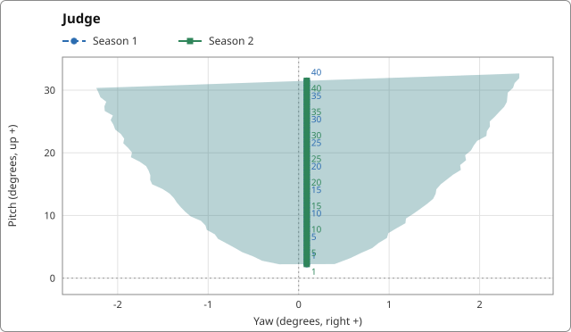 |
| M1911 | Pistol | none -> none | 7.5 -> 7.5 / 15 -> 15 / 22.5 -> 22.5 | 430 -> 430 | 0.5 s -> 0.5 s | 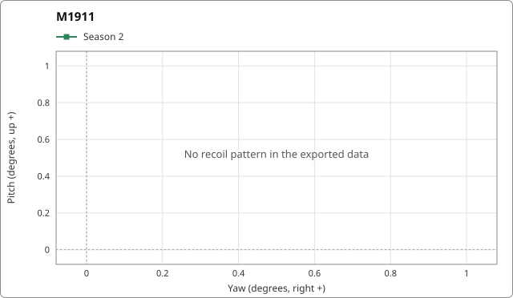 |

## Submachine guns

| Name | Class | Shots in pattern | Vertical climb after 10 / 20 / 30 shots, degrees (S1 -> S2) | RPM (S1 -> S2) | Reset time (S1 -> S2) | Pattern image |
|---|---|---:|---|---:|---:|---|
| AMP-9 | SMG | 30 -> 30 | 8.26 -> 8.26 / 15.91 -> 15.91 / 23.01 -> 23.01 | 900 -> 900 | 0.55 s -> 0.55 s | 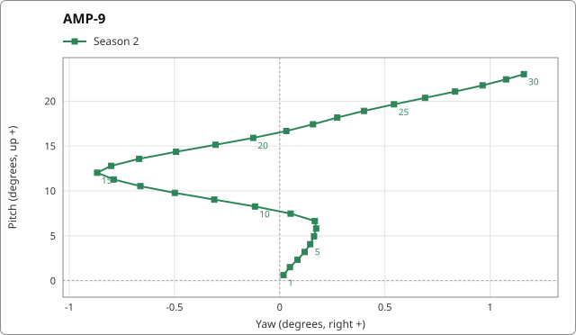 |
| MP5 | SMG | 30 -> 30 | 8.76 -> 8.76 / 16.65 -> 16.65 / 23.96 -> 23.96 | 800 -> 800 | 0.5 s -> 0.5 s | 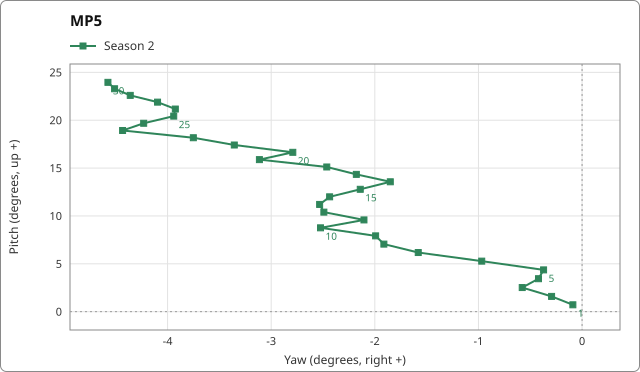 |
| PP-19 Bizon | SMG | — -> 30 | — -> 12.86 / — -> 24.69 / — -> 34.84 | — -> 700 | — -> 0.6 s | 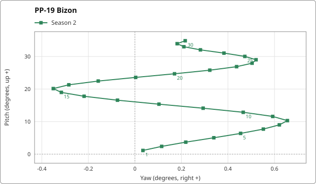 |
| PP-19 Vityaz | SMG | 30 -> 30 | 12.3 -> 12.3 / 23.62 -> 23.62 / 33.32 -> 33.32 | 800 -> 800 | 0.55 s -> 0.55 s | 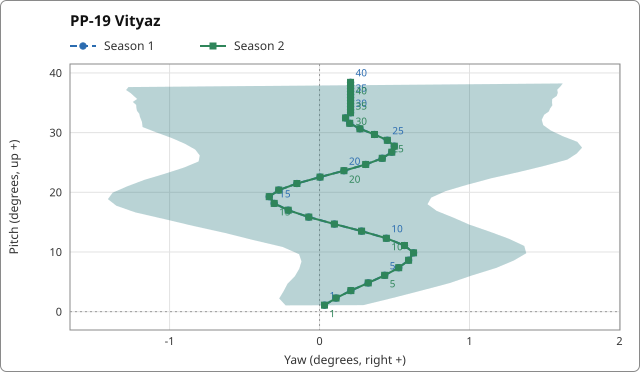 |
| Super-45 | SMG | 55 -> 55 | 0.45 -> 0.45 / 1.08 -> 1.08 / 1.08 -> 1.08 | 1200 -> 1200 | 0.48 s -> 0.48 s | 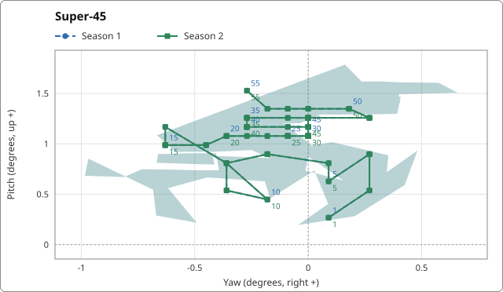 |

## Shotguns

| Name | Class | Shots in pattern | Vertical climb after 10 / 20 / 30 shots, degrees (S1 -> S2) | RPM (S1 -> S2) | Reset time (S1 -> S2) | Pattern image |
|---|---|---:|---|---:|---:|---|
| M500 | Shotgun | 7 -> 7 | 17.55 -> 17.55 / 30.05 -> 30.05 / 42.55 -> 42.55 | 120 -> 120 | 1 s -> 1 s | 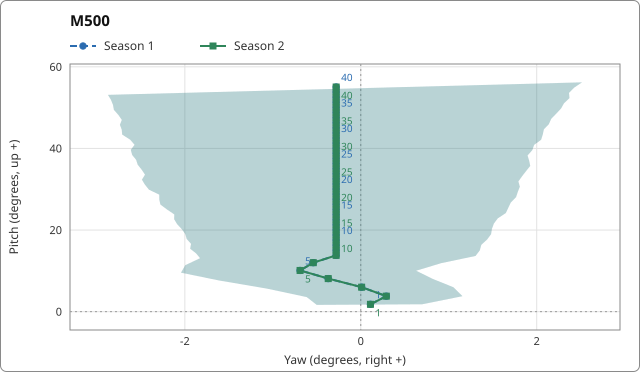 |
| MP43 | Shotgun | 2 -> 2 | 12.44 -> 12.44 / 23.44 -> 23.44 / 34.44 -> 34.44 | 900 -> 900 | 1.2 s -> 1.2 s | 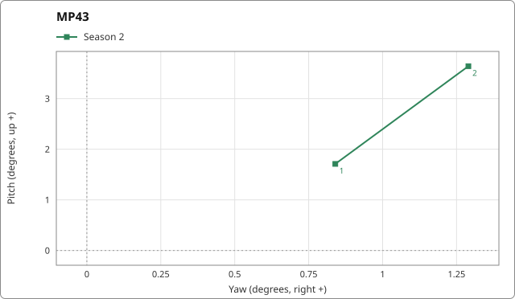 |

## Sniper rifles

| Name | Class | Shots in pattern | Vertical climb after 10 / 20 / 30 shots, degrees (S1 -> S2) | RPM (S1 -> S2) | Reset time (S1 -> S2) | Pattern image |
|---|---|---:|---|---:|---:|---|
| AMR 50 | Sniper | none -> none | 17.5 -> 17.5 / 35 -> 35 / 52.5 -> 52.5 | 41.5 -> 41.5 | 0.5 s -> 0.5 s | 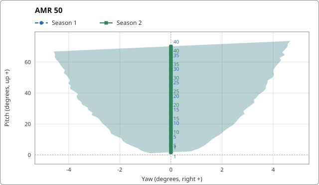 |
| MK22 | Sniper | none -> none | 15 -> 15 / 30 -> 30 / 45 -> 45 | 46 -> 46 | 0.5 s -> 0.5 s |  |
| Mosin Nagant | Sniper | none -> none | 25 -> 25 / 50 -> 50 / 75 -> 75 | 46 -> 46 | 0.2 s -> 0.2 s | 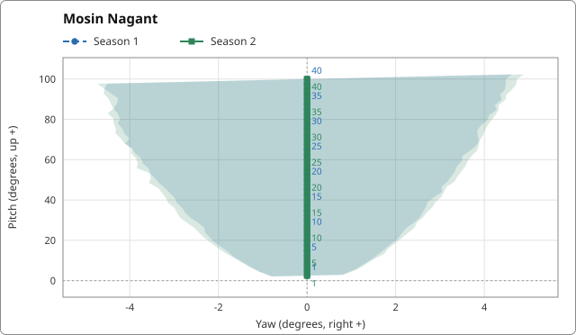 |
| Scout Rifle TD | Sniper | none -> none | 15 -> 15 / 30 -> 30 / 45 -> 45 | 46 -> 46 | 0.5 s -> 0.5 s | 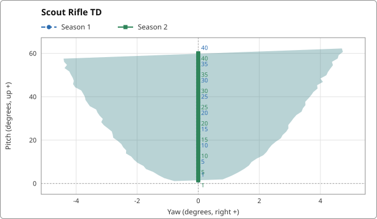 |
| SV98 | Sniper | none -> none | 15 -> 15 / 30 -> 30 / 45 -> 45 | 46 -> 46 | 0.5 s -> 0.5 s | 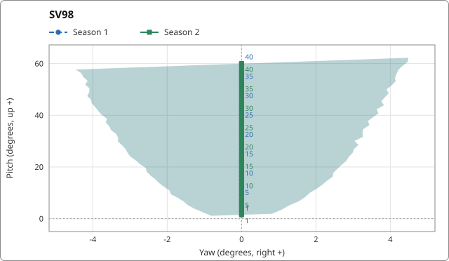 |

Vehicle, stationary and test weapons (23)

| Name | Class | Shots in pattern | Vertical climb after 10 / 20 / 30 shots, degrees (S1 -> S2) | RPM (S1 -> S2) | Reset time (S1 -> S2) | Pattern image |
|---|---|---:|---|---:|---:|---|
| AT4 | Launcher | none -> none | 15 -> 15 / 30 -> 30 / 45 -> 45 | 100 -> 100 | 0.5 s -> 0.5 s | 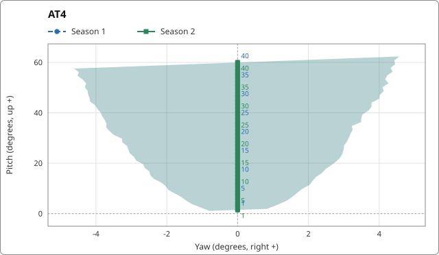 |
| Tank Barrel Test | Launcher | none -> none | 15 -> 15 / 30 -> 30 / 45 -> 45 | 100 -> 100 | 0.5 s -> 0.5 s | 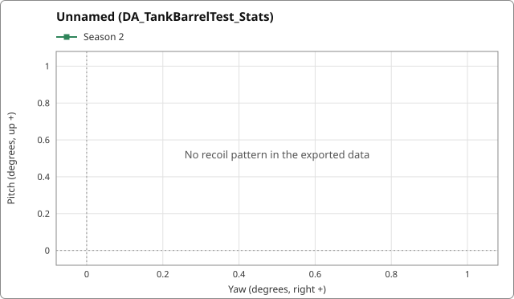 |
| TEST Grenade Launcher | Launcher | none -> none | 15 -> 15 / 30 -> 30 / 45 -> 45 | 75 -> 75 | 0.5 s -> 0.5 s | 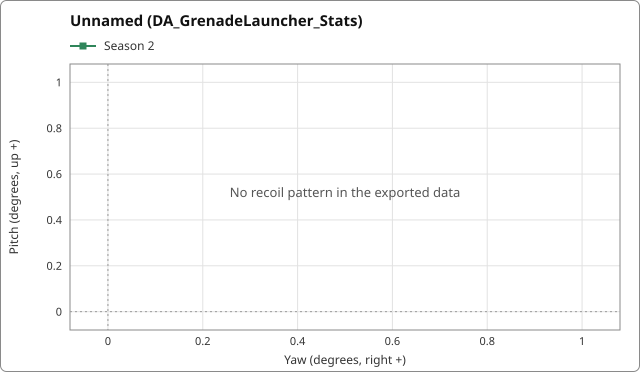 |
| Fists | Other | none -> none | 15 -> 15 / 30 -> 30 / 45 -> 45 | 300 -> 300 | 0.5 s -> 0.5 s | 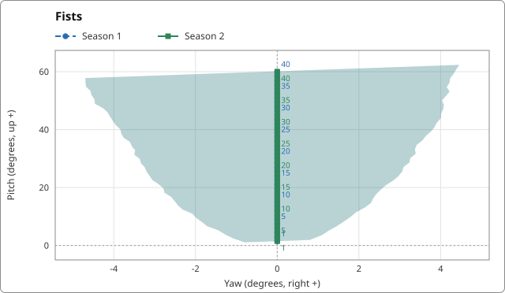 |
| Unnamed (BuildTool) | Other | none -> none | 15 -> 15 / 30 -> 30 / 45 -> 45 | 600 -> 600 | 0.5 s -> 0.5 s |  |
| Browning MG | Stationary | 29 -> 29 | 8.44 -> 8.44 / 15.16 -> 15.16 / 24.9 -> 24.9 | 500 -> 500 | 0.5 s -> 0.5 s | 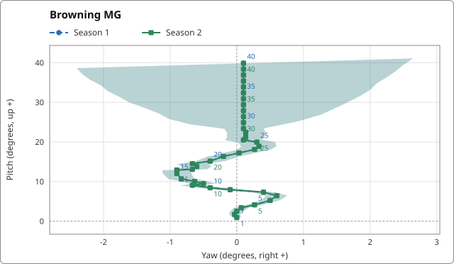 |
| 2A42 Autocannon (Havoc) | Vehicle | none -> none | 15 -> 15 / 30 -> 30 / 45 -> 45 | 250 -> 250 | 0.5 s -> 0.5 s |  |
| 2A46M-5 Cannon (T-72B3) | Vehicle | — -> none | — -> 0 / — -> 0 / — -> 0 | — -> 50 | — -> 0.5 s | 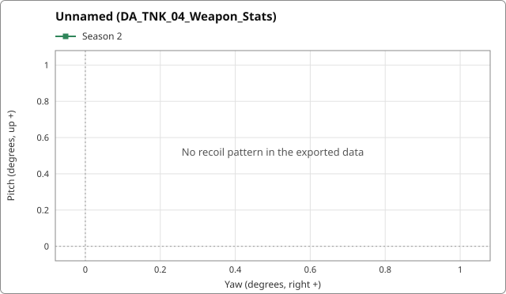 |
| Artillery Barrel Test | Vehicle | none -> none | 15 -> 15 / 30 -> 30 / 45 -> 45 | 150 -> 150 | 0.5 s -> 0.5 s | 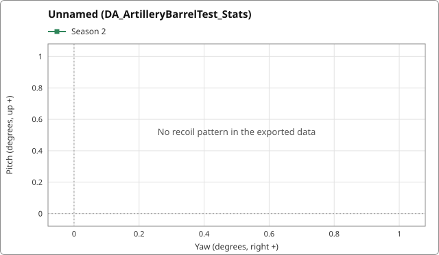 |
| B-13 Rocket Pods (AH-6M) | Vehicle | none -> none | 15 -> 15 / 30 -> 30 / 45 -> 45 | 350 -> 350 | 0.5 s -> 0.5 s | 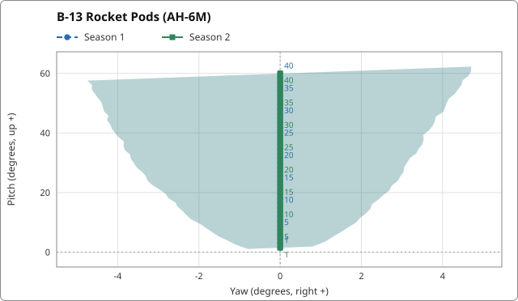 |
| B-13 Rocket Pods (Havoc) | Vehicle | none -> none | 15 -> 15 / 30 -> 30 / 45 -> 45 | 500 -> 500 | 0.5 s -> 0.5 s | 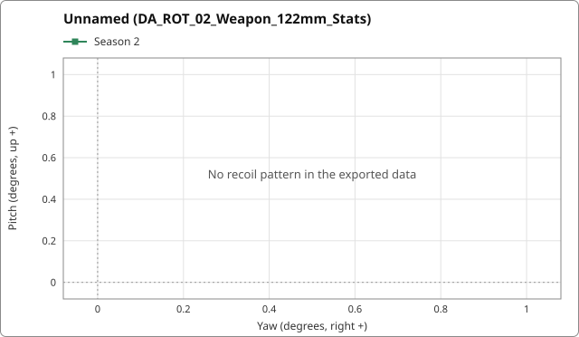 |
| Duel 35mm Oerlikon GDF Cannons (L2A6) | Vehicle | none -> none | 0 -> 0 / 0 -> 0 / 0 -> 0 | 1100 -> 1100 | 0 s -> 0 s | 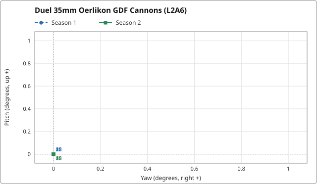 |
| L52 Cannon (L2A6) | Vehicle | none -> none | 0 -> 0 / 0 -> 0 / 0 -> 0 | 50 -> 50 | 0 s -> 0 s | 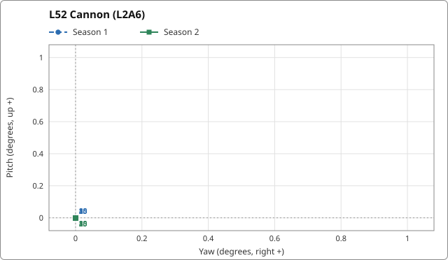 |
| L55A1 Cannon (L2A6) | Vehicle | none -> none | 0 -> 0 / 0 -> 0 / 0 -> 0 | 50 -> 50 | 0.5 s -> 0.5 s | 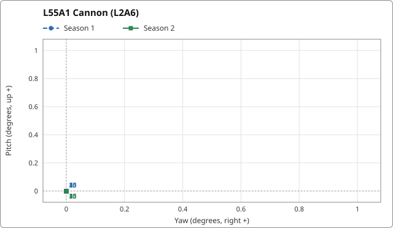 |
| M134D Minigun (AH-6M) | Vehicle | 7 -> 7 | 13.14 -> 13.14 / 13.14 -> 13.14 / 13.14 -> 13.14 | 1500 -> 1500 | 0.5 s -> 0.5 s | 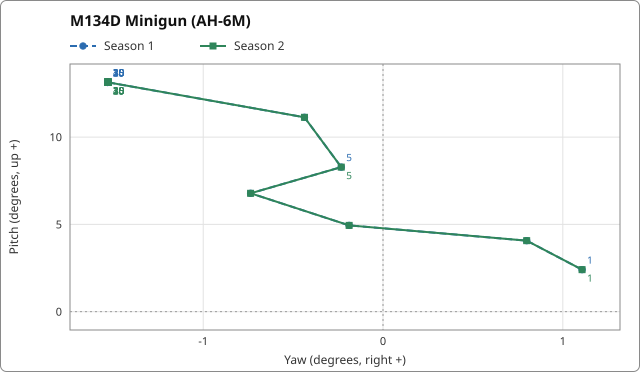 |
| M134D Minigun (Humvee) | Vehicle | 7 -> 7 | 13.14 -> 13.14 / 13.14 -> 13.14 / 13.14 -> 13.14 | 1500 -> 1500 | 0.5 s -> 0.5 s |  |
| MachineGun (Z20 Lakota) | Vehicle | 7 -> 7 | 13.11 -> 13.11 / 13.11 -> 13.11 / 13.11 -> 13.11 | 1500 -> 1500 | 0.5 s -> 0.5 s |  |
| MG3A1 Coaxial Gun (L2A6) | Vehicle | none -> none | 0 -> 0 / 0 -> 0 / 0 -> 0 | 650 -> 650 | 0.5 s -> 0.5 s |  |
| Mortar (L81 Mortar) | Vehicle | none -> none | 0 -> 0 / 0 -> 0 / 0 -> 0 | 50 -> 50 | 0.5 s -> 0.5 s |  |
| Mounted M2 Browning (MG Nest) / M2 Browning Machine Gun (T-72B3) / M2 Browning Machine Gun (Wolf-110) | Vehicle | — -> none | — -> 0 / — -> 0 / — -> 0 | — -> 600 | — -> 0.5 s |  |
| Mounted Verba (Talon 9K-SAM) | Vehicle | none -> none | 0 -> 0 / 0 -> 0 / 0 -> 0 | 100 -> 100 | 0.5 s -> 0.5 s |  |
| Mounted Verba (Vanguard CIWS) | Vehicle | none -> none | 0 -> 0 / 0 -> 0 / 0 -> 0 | 1800 -> 1800 | 0.5 s -> 0.5 s |  |
| Stingray | Vehicle | none -> none | 0 -> 0 / 0 -> 0 / 0 -> 0 | 50 -> 50 | 0.5 s -> 0.5 s |  |

