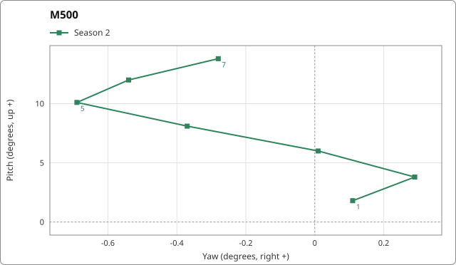

# Spray Patterns Gallery

Every weapon's recoil spray pattern, one picture each, with Season 1 and Season 2 on the same axes. 40 infantry weapons are in the tables below by class; 21 vehicle, stationary and test entries are in the collapsed section at the end.

The interactive viewer is at [Spray Pattern Viewer](../pipelines/spray-viewer.html).

> **Data status:** provisional. The Season 1 columns and some values will change when the final export is merged.

## Legend

- **Blue, dashed, round markers** = Season 1. **Green, solid, square markers** = Season 2.
- **Numbers on the path** = shot number (1, every 5th shot, and the last shot).
- **Shaded band** = the p10 to p90 range of the simulated spray (the area where most shots land).
- **x axis** = yaw in degrees, right is +. **y axis** = pitch in degrees, up is +. Each chart has its own scale, so read the tick labels.
- **Vertical climb** = how far the aim has risen after that many shots, in degrees.
- **RPM** = rounds per minute. **Reset time** = seconds of no fire before the pattern starts again.
- A dash (—) means the value is not in the exported data for that season.

## Assault rifles

| Name | Class | Shots in pattern | Vertical climb after 10 / 20 / 30 shots, degrees (S1 -> S2) | RPM (S1 -> S2) | Reset time (S1 -> S2) | Pattern image |
|---|---|---:|---|---:|---:|---|
| A-91 | AR | — -> 30 | — -> 11.94 / — -> 23.73 / — -> 34.62 | — -> 700 | — -> 0.78 s |  |
| AK74 | AR | — -> 30 | — -> 11.09 / — -> 22.13 / — -> 32.46 | — -> 650 | — -> 0.65 s |  |
| Bushmaster M17S | AR | — -> 30 | — -> 11.94 / — -> 23.73 / — -> 34.62 | — -> 700 | — -> 0.78 s |  |
| FAL | AR | — -> 20 | — -> 15.84 / — -> 30.85 / — -> n/a | — -> 650 | — -> 0.7 s |  |
| Galil | AR | — -> 30 | — -> 10.06 / — -> 21.34 / — -> 31.09 | — -> 650 | — -> 0.8 s |  |
| KH-2002 | AR | — -> 30 | — -> 11.94 / — -> 23.73 / — -> 34.62 | — -> 700 | — -> 0.78 s |  |
| M4 | AR | — -> 30 | — -> 10.42 / — -> 20.53 / — -> 29.83 | — -> 800 | — -> 0.55 s |  |
| T-21 | AR | — -> 30 | — -> 11.21 / — -> 25.64 / — -> 42.4 | — -> 750 | — -> 0.8 s |  |

## Bows

| Name | Class | Shots in pattern | Vertical climb after 10 / 20 / 30 shots, degrees (S1 -> S2) | RPM (S1 -> S2) | Reset time (S1 -> S2) | Pattern image |
|---|---|---:|---|---:|---:|---|
| Compound Bow | Bow | — -> none | — -> — / — -> — / — -> — | — -> — | — -> 0.2 s |  |

## Marksman rifles

| Name | Class | Shots in pattern | Vertical climb after 10 / 20 / 30 shots, degrees (S1 -> S2) | RPM (S1 -> S2) | Reset time (S1 -> S2) | Pattern image |
|---|---|---:|---|---:|---:|---|
| BMR-308 | DMR | — -> 20 | — -> 27.86 / — -> 52.6 / — -> n/a | — -> 450 | — -> 1 s |  |
| M14 | DMR | — -> 32 | — -> 31.32 / — -> 65.52 / — -> 102.78 | — -> 700 | — -> 1.1 s |  |
| SKS | DMR | — -> 20 | — -> 33.61 / — -> 64.76 / — -> n/a | — -> 420 | — -> 0.95 s |  |
| SVD | DMR | — -> 9 | — -> n/a / — -> n/a / — -> n/a | — -> 480 | — -> 1.1 s |  |
| TCX-SPR | DMR | — -> 30 | — -> 15.91 / — -> 31.26 / — -> 45.76 | — -> 800 | — -> 0.5 s |  |

## Light machine guns

| Name | Class | Shots in pattern | Vertical climb after 10 / 20 / 30 shots, degrees (S1 -> S2) | RPM (S1 -> S2) | Reset time (S1 -> S2) | Pattern image |
|---|---|---:|---|---:|---:|---|
| Evo-3 Ultra | LMG | — -> 40 | — -> 30.98 / — -> 60.24 / — -> 87.9 | — -> 700 | — -> 0.75 s |  |
| M249 SAW | LMG | — -> 7 | — -> n/a / — -> n/a / — -> n/a | — -> 850 | — -> 0.5 s |  |
| PKM | LMG | — -> 30 | — -> 24.02 / — -> 47.68 / — -> 68.11 | — -> — | — -> 0.9 s |  |

## Launchers

| Name | Class | Shots in pattern | Vertical climb after 10 / 20 / 30 shots, degrees (S1 -> S2) | RPM (S1 -> S2) | Reset time (S1 -> S2) | Pattern image |
|---|---|---:|---|---:|---:|---|
| 9K333 Verba | Launcher | — -> none | — -> — / — -> — / — -> — | — -> — | — -> 0.5 s |  |
| MAAWS | Launcher | — -> none | — -> — / — -> — / — -> — | — -> — | — -> 0.5 s |  |
| MGL-40 | Launcher | — -> none | — -> — / — -> — / — -> — | — -> — | — -> 0.5 s |  |

## Pistols

| Name | Class | Shots in pattern | Vertical climb after 10 / 20 / 30 shots, degrees (S1 -> S2) | RPM (S1 -> S2) | Reset time (S1 -> S2) | Pattern image |
|---|---|---:|---|---:|---:|---|
| Deagle | Pistol | — -> 15 | — -> 13.05 / — -> n/a / — -> n/a | — -> 267 | — -> 0.5 s |  |
| GGX 17 | Pistol | — -> none | — -> — / — -> — / — -> — | — -> — | — -> 0.5 s |  |
| GGX 18 | Pistol | — -> 50 | — -> 15.88 / — -> 31.94 / — -> 41.94 | — -> 1200 | — -> 0.5 s |  |
| Judge | Pistol | — -> 1 | — -> n/a / — -> n/a / — -> n/a | — -> 200 | — -> 0.5 s |  |
| M1911 | Pistol | — -> none | — -> — / — -> — / — -> — | — -> 430 | — -> 0.5 s |  |

## Submachine guns

| Name | Class | Shots in pattern | Vertical climb after 10 / 20 / 30 shots, degrees (S1 -> S2) | RPM (S1 -> S2) | Reset time (S1 -> S2) | Pattern image |
|---|---|---:|---|---:|---:|---|
| AMP-9 | SMG | — -> 30 | — -> 8.26 / — -> 15.91 / — -> 23.01 | — -> 900 | — -> 0.55 s |  |
| MP5 | SMG | — -> 30 | — -> 8.76 / — -> 16.65 / — -> 23.96 | — -> 800 | — -> 0.5 s |  |
| PP-19 Bizon | SMG | — -> 30 | — -> 12.86 / — -> 24.69 / — -> 34.84 | — -> 700 | — -> 0.6 s |  |
| PP-19 Vityaz | SMG | — -> 30 | — -> 12.3 / — -> 23.62 / — -> 33.32 | — -> 800 | — -> 0.55 s |  |
| Super-45 | SMG | — -> 55 | — -> 0.45 / — -> 1.08 / — -> 1.08 | — -> 1200 | — -> 0.48 s |  |

## Shotguns

| Name | Class | Shots in pattern | Vertical climb after 10 / 20 / 30 shots, degrees (S1 -> S2) | RPM (S1 -> S2) | Reset time (S1 -> S2) | Pattern image |
|---|---|---:|---|---:|---:|---|
| M500 | Shotgun | — -> 7 | — -> n/a / — -> n/a / — -> n/a | — -> 120 | — -> 1 s |  |
| MP43 | Shotgun | — -> 2 | — -> n/a / — -> n/a / — -> n/a | — -> 900 | — -> 1.2 s |  |

## Sniper rifles

| Name | Class | Shots in pattern | Vertical climb after 10 / 20 / 30 shots, degrees (S1 -> S2) | RPM (S1 -> S2) | Reset time (S1 -> S2) | Pattern image |
|---|---|---:|---|---:|---:|---|
| AMR 50 | Sniper | — -> none | — -> — / — -> — / — -> — | — -> 41.5 | — -> 0.5 s |  |
| MK22 | Sniper | — -> none | — -> — / — -> — / — -> — | — -> 46 | — -> 0.5 s |  |
| Mosin Nagant | Sniper | — -> none | — -> — / — -> — / — -> — | — -> 46 | — -> 0.2 s |  |
| Scout Rifle TD | Sniper | — -> none | — -> — / — -> — / — -> — | — -> 46 | — -> 0.5 s |  |
| SV98 | Sniper | — -> none | — -> — / — -> — / — -> — | — -> 46 | — -> 0.5 s |  |

## Unclassified

| Name | Class | Shots in pattern | Vertical climb after 10 / 20 / 30 shots, degrees (S1 -> S2) | RPM (S1 -> S2) | Reset time (S1 -> S2) | Pattern image |
|---|---|---:|---|---:|---:|---|
| Unnamed (DA_AT4_Stats) | Unclassified | — -> none | — -> — / — -> — / — -> — | — -> — | — -> 0.5 s |  |
| Unnamed (DA_GrenadeLauncher_Stats) | Unclassified | — -> none | — -> — / — -> — / — -> — | — -> — | — -> 0.5 s |  |
| Unnamed (DA_RPG7_Stats) | Unclassified | — -> none | — -> — / — -> — / — -> — | — -> — | — -> 0.5 s |  |

Vehicle, stationary and test weapons (21)

| Name | Class | Shots in pattern | Vertical climb after 10 / 20 / 30 shots, degrees (S1 -> S2) | RPM (S1 -> S2) | Reset time (S1 -> S2) | Pattern image |
|---|---|---:|---|---:|---:|---|
| Unnamed (DA_M2Browning_Stats) | Stationary | — -> 29 | — -> 8.44 / — -> 15.16 / — -> n/a | — -> — | — -> 0.5 s |  |
| Unnamed (DA_ArtilleryBarrelTest_Stats) | Test | — -> none | — -> — / — -> — / — -> — | — -> — | — -> 0.5 s |  |
| Unnamed (DA_BuildTool_Stats) | Test | — -> none | — -> — / — -> — / — -> — | — -> — | — -> 0.5 s |  |
| Unnamed (DA_Fists_Stats) | Test | — -> none | — -> — / — -> — / — -> — | — -> — | — -> 0.5 s |  |
| Unnamed (DA_TankBarrelTest_Stats) | Test | — -> none | — -> — / — -> — / — -> — | — -> — | — -> 0.5 s |  |
| Unnamed (DA_MWSY_001_Heavy_MountedMachineGun_Stats) | Vehicle | — -> none | — -> — / — -> — / — -> — | — -> — | — -> 0.5 s |  |
| Unnamed (DA_ROT_02_Weapon_122mm_Stats) | Vehicle | — -> none | — -> — / — -> — / — -> — | — -> — | — -> 0.5 s |  |
| Unnamed (DA_ROT_02_Weapon_30mmCannon_Stats) | Vehicle | — -> none | — -> — / — -> — / — -> — | — -> — | — -> 0.5 s |  |
| Unnamed (DA_ROT_03_AttachedMachineGuns_Stats) | Vehicle | — -> 7 | — -> n/a / — -> n/a / — -> n/a | — -> — | — -> 0.5 s |  |
| Unnamed (DA_ROT_03_Weapon_122mm_Stats) | Vehicle | — -> none | — -> — / — -> — / — -> — | — -> — | — -> 0.5 s |  |
| Unnamed (DA_ROT_04_MountedMachineGun_Stats) | Vehicle | — -> 7 | — -> n/a / — -> n/a / — -> n/a | — -> — | — -> 0.5 s |  |
| Unnamed (DA_STN_01_Heavy_MountedMachineGun_Stats) | Vehicle | — -> none | — -> — / — -> — / — -> — | — -> — | — -> 0.5 s |  |
| Unnamed (DA_STN_02_Heavy_MainCannon_Stats) | Vehicle | — -> none | — -> — / — -> — / — -> — | — -> — | — -> 0.5 s |  |
| Unnamed (DA_STN_03_Heavy_MainBarrel_Stats) | Vehicle | — -> none | — -> — / — -> — / — -> — | — -> — | — -> 0.5 s |  |
| Unnamed (DA_STN_05_Heavy_MainBarrel_Stats) | Vehicle | — -> none | — -> — / — -> — / — -> — | — -> — | — -> 0.5 s |  |
| Unnamed (DA_TNK_01_Artillery_Weapon_Stats) | Vehicle | — -> none | — -> — / — -> — / — -> — | — -> — | — -> 0 s |  |
| Unnamed (DA_TNK_01_Heavy_Weapon_Stats) | Vehicle | — -> none | — -> — / — -> — / — -> — | — -> — | — -> 0.5 s |  |
| Unnamed (DA_TNK_01_MachineGun_Weapon_Stats) | Vehicle | — -> none | — -> — / — -> — / — -> — | — -> — | — -> 0.5 s |  |
| Unnamed (DA_TNK_03_Weapon_Stats) | Vehicle | — -> none | — -> — / — -> — / — -> — | — -> — | — -> 0 s |  |
| Unnamed (DA_TNK_04_Weapon_Stats) | Vehicle | — -> none | — -> — / — -> — / — -> — | — -> — | — -> 0.5 s |  |
| Unnamed (DA_WHL_05_RingMinigun_Stats) | Vehicle | — -> 7 | — -> n/a / — -> n/a / — -> n/a | — -> — | — -> 0.5 s |  |

